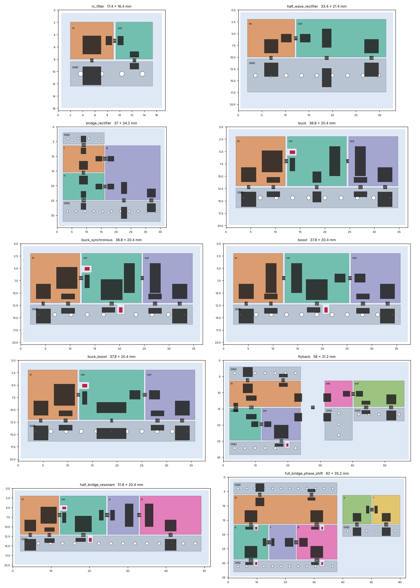

# Circuits (`pcbqs.circuit`)

A general circuit simulator for power switching circuits: the model lists parts, nodes and drives, and the
engine builds an ngspice deck from exactly that, runs it until it repeats, adjusts whatever the model says may be
adjusted until its targets are met, and reports what every part does. Nothing in it knows what kind of converter
it is running.

    python -m pcbqs.circuit --templates                 # the example circuits
    python -m pcbqs.circuit --template boost > boost.json
    python -m pcbqs.circuit boost.json --out result --jobs 4
    python -m pcbqs.circuit boost.json --set parameters.vin=9 --set R1.resistance_ohm=24
    python -m pcbqs.circuit boost.json --out result --copper          # with its board's copper
    python -m pcbqs.circuit boost.json --out result --fields          # and the H and E fields over the board
    python -m pcbqs.circuit --from-kicad board.kicad_pcb > model.json  # the parts of a KiCad design

## The model (format 2)

```json
{"format": 2, "name": "Boost converter",
 "parameters": {"fsw": 200e3, "vin": 12, "vout": 24, "pout": 12},
 "parts": [
  {"ref": "V1", "type": "source",    "nodes": ["in", "0"],   "dc_V": "vin", "R_ohm": 0.05},
  {"ref": "L1", "type": "inductor",  "nodes": ["in", "sw"],  "value": "47u", "DCR_ohm": 0.05},
  {"ref": "Q1", "type": "switch",    "nodes": ["sw", "0"],   "drive": "pwm", "model": {"Ron_ohm": 0.03}},
  {"ref": "D1", "type": "diode",     "nodes": ["sw", "out"], "model": {"Vf_V": 0.45, "Cj_F": "100p"}},
  {"ref": "C2", "type": "capacitor", "nodes": ["out", "0"],  "value": "22u", "ESR_ohm": 0.01},
  {"ref": "R1", "type": "load",      "nodes": ["out", "0"],  "resistance_ohm": "vout*vout/pout"}],
 "drives":   {"pwm": {"frequency_Hz": "fsw", "duty": 0.5}},
 "probes":   {"vout": {"voltage": ["out", "0"]}, "il": {"current": "L1"}},
 "measures": {"vout_avg": {"avg": "vout"}, "il_ripple": {"pp": "il"}},
 "targets":  [{"adjust": "drives.pwm.duty", "range": [0.05, 0.9], "measure": "vout_avg", "value": "vout"}],
 "sweep":    {"parameters.vin": [9, 12, 15]}}
```

A value is a number, engineering notation (`22u`, `4.7k`, `100n`) or an expression over the parameters
(`1/((2*pi*fsw)**2*l)`; `+ - * / **`, `pi`, `sqrt abs min max exp log`). A path names a number anywhere in the
model: `parameters.vin`, `drives.pwm.duty`, `R1.resistance_ohm`, `Q1.model.Ron_ohm`, `couplings.0.k`.

| part | nodes | fields |
|---|---|---|
| `resistor` | a, b | `value` |
| `capacitor` | a, b | `value`, `ESR_ohm`, `ESL_H`, `leakage_ohm`, `bias_factor` |
| `inductor` | a, b | `value`, `DCR_ohm`; with `SRF_Hz` / `Cp_F` / `core_R_ohm`, a winding with self-capacitance and core loss |
| `diode` | anode, cathode | `model`: `Vf_V` at `If_A` (0.7 V at 1 A), `n`, `R_ohm`, `Cj_F`, `TT_s` |
| `switch` | drain, source | `drive`, `invert`; `model`: `type` (`switch`, `ideal`, `mosfet`, `vdmos`, `subcircuit`), `Ron_ohm`, `Cds_F`, `body_diode`, `diode_TT_s`, ... |
| `source` | +, − | `dc_V`, or `wave` (`pulse`, `sine`, `pwl`), or `dc_A`; `R_ohm`, `L_H` in series |
| `load` | a, b | `resistance_ohm`, or `power_W`, or `current_A` (a resistor below `min_V`, so it starts) |

`0` or `GND` is ground. A part's current is taken as entering its first node, so its voltage times its current is
the power it absorbs.

- **couplings**: `{"inductors": ["LP", "LS"], "k": 0.98}`: a transformer is two inductors and a coupling. The dot
  is at each inductor's first node.
- **drives**: `frequency_Hz`, `duty`, `phase_deg`, `dead_time_s` (between the middles of one switch's fall and
  its complement's rise), `gate_V`, `rise_s`, `fall_s`. A switch follows its drive; with `invert` it is the
  drive's complement. Any number of drives, at frequencies in a whole-number ratio.
- **probes**: a voltage between two nodes, or a part's current, under a name.
- **measures**: `avg`, `rms`, `pp`, `max` or `min` of an expression of probes and parts' signals
  (`{"avg": "vout*il"}`, `{"max": "Q1.V"}`), over the last period. A part's signals are `<ref>.V`, `<ref>.I`; a
  capacitor's `<ref>.cap_V` (its capacitance's voltage, without its ESR's and ESL's drops) and a winding's
  `<ref>.winding_I`. With `samples` (`{"pp": "vhb", "samples": 256}`) the statistic is of that many evenly
  spaced instants of the period, as a scope sampling so often sees it: a filter's settled ripple, without the
  switching edges' spikes that fall between the instants (ngspice's own steps have them all).
- **targets**: adjust one number of the model, inside a range, until a measure (or `load_power_W`,
  `source_power_W`, `efficiency`, `loss_W`) has a value. Several targets, each with its own knob.
- **sweep**: paths and the values each takes; every combination is a point, in its own folder.
- **analysis**: `engine` (`"ngspice"`, the default, or `"pwl"`: [below](#the-piecewise-linear-engine)),
  `cycles` (200 periods a run), `periodic_tolerance` (0.003), `energy_tolerance` (0.002),
  `target_tolerance` (0.005), `max_cycles`, `samples_per_cycle`, `final_samples_per_cycle` (the reported run's),
  `period_s`, `ignore`, `solver` (ngspice's `reltol`, `method`, ...).

## A run

1. The first run starts from ngspice's DC solution at time zero, where every gate is still low: the rails are
   charged through the diodes and the inductors carry their DC current, whatever the circuit.
2. Each run starts where the last one stopped: every capacitor's voltage, every inductor's current, every
   switch's and diode's voltage.
3. It is settled when the state repeats (the last period against every period of the half-run before it) and
   the energy the circuit stores has stopped changing (by less than 0.2 % of the power it handles: that change
   is the error of an efficiency taken over the period). A run that has not settled is followed by one twice
   as long, started from the middle of whatever was still ringing.
4. Settled, each target is compared with its measure and its knob moved by a secant step. A target that cannot be
   reached inside its range ends the point saying which end it stopped at and what it gave there.
5. The reported run repeats a few periods at the strict tolerance (`reltol` 1e-4; the search runs at 1e-3) with
   steps four times finer. If ngspice cannot hold that, the search's result is reported and a note says so.

## The piecewise-linear engine

`python -m pcbqs.circuit model.json --engine pwl` (or `"analysis": {"engine": "pwl"}` in the model; *Engine* in
the window's Circuit settings) does not run a transient. Between two switching instants a converter of ideal
switches is a linear circuit, whose capacitor voltages and inductor currents have an exact solution (a matrix
exponential), so a period is a handful of those and the steady state is the state a period maps onto itself:
Newton's method on that map finds it in a few periods, where a transient runs hundreds to let an output filter
settle. A diode's state is the circuit's own: it turns on when its voltage reaches its threshold and off when
its current reaches zero, at the instant that happens, so discontinuous conduction, a rectifier's commutation
and the dead time's conduction through a body diode come out without being told. Everything after a run is the
same: the targets' search, the parts' figures, the supply's currents, the report.

What it models: a switch as its on resistance with its body diode and its drain-source capacitance (`Cds_F`, a
state of its own, so turning on discharges it through the switch, as it does in ngspice's deck) and its package's
inductances; a diode as a threshold and a resistance; capacitors with their ESR, ESL and leakage; inductors and
windings (self-capacitance and core loss); coupled inductors; sources with a sine or a pulse; the board's copper.
The targets are searched on the period's own samples, each run starting from the last one's state; the reported
run starts from the accepted one's and is sampled as finely as the circuit rings (the copper's or a package's
inductance against a switch's capacitance, hundreds of MHz, in the topologies the period goes through:
`Plant.resolution`; `analysis.final_samples_per_cycle` sets it instead), and after each switching instant as
finely as its fastest transient, so a capacitance discharged in picoseconds is in the averages (a part's power
among them); RMS values and peaks are of the regular samples. `transient.npz` keeps `samples_per_cycle` (8192)
of each period, every so many of those.

The edges are instant. A switch that opens on an inductance's current with no capacitance across it (its
package's inductance, the copper's) cuts that current off: the node's voltage leaps, so an off diode that the leap
forward-biases takes the current at once (a converter's free-wheeling diode, a body diode in the dead time),
and what no diode takes jumps to the currents Kirchhoff's law allows, the inductances' flux kept as a voltage
impulse would leave it. The energy that jump takes, about half L I squared, is put in the switch that opened,
as ngspice's switch takes it over the gate's edge, and the notes say how much where it is more than a thousandth
of the power.

The examples alone (2026-11-14; the time is the whole run, its targets' search included):

| Example | ngspice | pwl | Agreement |
|---|---|---|---|
| Buck | 5.8 s | 0.7 s | duty 0.4462 / 0.4458, output ripple 6.75 / 6.74 mV, efficiency 93.63 / 93.67 % |
| Synchronous buck, 0.5 A | 39.9 s | 2.0 s | duty 0.2872 / 0.2867, inductor ripple 0.438 / 0.438 A, efficiency 98.17 / 98.24 % |
| Boost | 13.9 s | 0.7 s | duty 0.5143 / 0.5139, output ripple 65.4 / 65.4 mV, efficiency 97.51 / 97.55 % |
| Buck-boost | 17.3 s | 0.7 s | duty 0.5663 / 0.5660, efficiency 95.76 / 95.83 % |
| Flyback (coupled inductors) | 11.3 s | 0.9 s | duty 0.3347 / 0.3355, switch peak 64.3 / 65.4 V, efficiency 82.1 / 81.7 % |
| Resonant half bridge, 130 kHz | 4.2 s | 1.0 s | tank current 1.413 / 1.413 A, efficiency 98.14 / 98.15 % |
| Phase-shifted full bridge | 9.9 s | 1.3 s | phase 54.34 / 54.31°, currents within 0.1 %, efficiency 94.50 / 94.56 % |
| Bridge rectifier on a sine | 0.4 s | 0.5 s | DC output 30.35 / 30.27 V, ripple 2.365 / 2.364 V, mains current 1.540 / 1.528 A |
| Half-wave rectifier; RC filter on a pulse | 0.3 s; 0.6 s | 0.3 s; 0.2 s | output and ripple within 0.4 % |

On their boards' copper (2026-11-14, after the cut currents' fix; `--copper`: every part on its pads, the copper's
R-L model between them; the copper's loss is its own dissipation, I^T R I and its Foster sections', not the
ports' V x I, whose reactive parts cancel only in the sum):

| Example | ngspice | pwl | Efficiency | Copper loss | Agreement |
|---|---|---|---|---|---|
| Half-wave rectifier | 0.5 s | 0.5 s | 94.28 / 94.26 % | 0.23 / 0.23 mW | output, ripple and peak within 0.4 % |
| Bridge rectifier | 0.9 s | 1.8 s | 94.06 / 93.87 % | 5.00 / 4.93 mW | as alone |
| Buck | 9.5 s | 1.0 s | 93.57 / 93.59 % | 7.47 / 7.04 mW | output and inductor ripple within 0.1 % |
| Synchronous buck, 0.5 / 2 / 4 A | 22–50 s | 1.7–1.9 s | 98.18 / 98.22, 96.63 / 96.67, 94.12 / 94.14 % | 1.91 / 1.84, 8.45 / 8.19, 28.8 / 28.3 mW | output within 0.1 %, ripple 0.1 % |
| Boost | 20.2 s | 1.1 s | 97.50 / 97.53 % | 2.32 / 1.94 mW | output, inductor ripple within 0.1 % |
| Buck-boost | 21.6 s | 1.0 s | 95.75 / 95.80 % | 2.27 / 1.79 mW | as alone |
| Flyback | 18.8 s | 1.5 s | 82.03 / 81.64 % | 4.27 / 4.21 mW | switch peak 64.3 / 65.4 V, primary peak 0.973 / 0.975 A |
| Resonant half bridge, 3 points | 4–5 s | 1.5–2.3 s | within 0.03 % | within 1 % | tank and load RMS the same |
| Phase-shifted full bridge | 26.4 s | 4.0 s | 94.45 / 94.47 % | 14.3 / 12.7 mW | phase, currents within 0.1 % |

What it leaves out is where the tables differ. A switch's gate is ideal (no gate charge, no edge: ngspice's
switch turns on over its rise time; its gate capacitances are said in the notes); a diode, a switch's body diode
among them, has no junction capacitance and no reverse recovery (`Cj_F`, `TT_s`, `diode_TT_s`: the notes say
which parts have them; a constant Cj put a bridge rectifier's floating AC side on the junctions' charge, whose
steady state the search could not pin down; ngspice's falls with the reverse voltage). A switch that turns on
against a recovering body diode loses less here: on the wpthb bridge, a point of efficiency. On copper, the
diodes' recovery and junction currents through the copper's loops are ngspice's alone: the copper loss of the
buck, the boost, the buck-boost and the full bridge is 6 to 21 % lower. A peak to peak on copper (an output's
"ripple") is the switching edges' spikes through the copper's inductance, which the two engines put very
differently (ngspice's 20 V on the buck's output, this one's 91 mV: its edges are instant): averages and RMS values
agree. The power balance closes to a few parts in a million. A source with
a piecewise-linear wave and a MOSFET or subcircuit switch model stop it with a line saying they are ngspice's.

## Results

`<out>/circuit.json`: `{format, name, complete, sweep, cases, failed}`. Each case, also in `<out>/<point>/case.json`
beside `circuit.cir`, `transient.npz` (every signal, uniformly sampled), `model.json` (the numbers it ran with)
and `waveforms.png`:

- `knobs`, `targets` (what each reached), `measures` (the model's own)
- `source_power_W`, `load_power_W`, `loss_W`, `efficiency`, `gate_drive_power_W`
- `parts`: for every part its `power_W`; a switch and a diode: `avg_A`, `rms_A`, `peak_A`, `peak_V`; a capacitor:
  `avg_V`, `ripple_V`, `rms_A`; an inductor: `avg_A`, `ripple_A`, `peak_A`, `rms_A`; a source and a load: `avg_V`,
  `avg_A`
- `coupled`: each set of coupled inductors with the power the set loses (one winding alone passes power to the
  other, so its own `power_W` is not a loss)
- `copper` (with `--copper`): `board`, `loss_W`, `fit_error`, `ports` (pad, its net's reference pad, `rms_A`)
- `fields` (with `--fields`): the largest H and E on each plane, each net's swing and capacitance, the files
- `supply`: what the parts draw from each supply (a node a DC source is on), for a power-integrity or near-field
  run: `node`, `net`, `volts`, the node's `capacitors`, and for every other part on it (parts on one footprint
  together) its `avg_A`, `rms_A` and `file`, `supply-<footprint>.csv` beside the case: 40 harmonics as `f_Hz`,
  `A` (peak), `deg` ([From one tool to the next](power-workflow.md#4-from-one-tool-to-the-next)). Behind an input
  filter (all the source feeds is a lone inductor or resistor in series to a node capacitors hold, as far as such
  parts lead; a boost's inductor feeds its switch, which none hold, and is a load) the node is the one behind it,
  `net` the source's, `rail_net` the node's, `through` the footprints the way passes on the board and `dcr` their
  DC resistance: the wpthb bridge's rail VIN, its loads Q1 and Q2 on VHB, through L3
- `stored_energy_change_W`: what went into the capacitors and inductors over the reported period, counted out of
  the parts' powers, the loss and the efficiency
- `periodic_error`, `energy_drift_relative`, `reltol`, `runs`, `periods`, `history` (every run of the search)
- `notes`: anything the result should be read with, such as a voltage no circuit gives

## What to give the parts

A switch or a diode with no capacitance, cutting off the current of an inductance that has nowhere else to go,
has no answer: ngspice either stops ("timestep too small") or returns a spike of thousands of volts, and the
case's notes say so. Give the switches `Cds_F` and the diodes `Cj_F` (a few hundred pF), as real ones have. A
bridge of diodes with none leaves its AC side floating while all four are off, and fails the same way.

A switch's body diode has no reverse recovery unless its model gives `diode_TT_s`; with it, a hard-switched leg
with no loop inductance shows recovery currents of tens of amps, which is the model's answer and not a fault.

## Examples

`rc_filter`, `half_wave_rectifier`, `bridge_rectifier` (constant-power load), `buck`, `buck_synchronous` (dead
time, a load sweep), `boost`, `buck_boost`, `flyback` (coupled inductors, an RCD clamp), `half_bridge_resonant` (a
frequency sweep), `full_bridge_phase_shift` (two drives; the phase between them is the knob). Each is checked in
`tests/test_circuit_examples.py` against its closed form: ripple and duty for the converters, harmonic by
harmonic for the resonant tank, charge and power balance for the rest.

`data/wpthb_bridge.json` (and `wpthb_bridge.toml`, under File > Examples > Circuits > Bridges) is the wpthb
board's 24 V full bridge driving a wireless-power link: its four switches on VHB (vdmos, with their packages'
inductances and Cds), the tank C25/C27/C30 into the primary coil on the test points TP15 and TP14, the input
filter R9, CA1 to CA4 and L3, and a receiver off the board (a coil like the primary, coupled by k = 0.4, its
series capacitor and its load, fixed at 130 nF and 5.65 ohm: tuned and matched at 90 kHz). Leg B's phase is the
target's knob, set so the load takes `P`; the sweep is 90 and 110 kHz at 5 to 30 W. Its board section names the
board's pads (`board.parts`, `board.reference`), so `--board wpthb.kicad_pcb --copper` puts the bridge on its
copper: 24 ports. At 90 kHz and 10 W, alone: phase 55.66°, input 10.71 W, efficiency 93.18 %, primary 1.435 A RMS
(42 s); the piecewise-linear engine 55.58°, 94.20 %, 1.436 A (7 s; its point of efficiency more is the body
diodes' recovery it leaves out). Its `bus_ripple_V` is VHB's settled ripple (256 samples a period),
`bus_spike_pp_V` the same with the edges' spikes. It was the model of the full-bridge tool
(`pcbqs.power_circuit`, format 1, removed 2026-11-14), which also tuned the receiver at each frequency; that
tool's answers at the same receiver: 55.64°, 93.13 %, 1.435 A.

## On a board

```json
"board": {"file": "06_boost.kicad_pcb", "parts": {"V1": "J1", "R1": "J2"}}
```

With `--copper` the board's copper is part of the circuit. A part's pin is the pads of its footprint on its
node's net (`0` is the board's GND), so nothing is said twice: the model says which part is on which node, the
board which pad is on which net. `board.parts` names a part's footprint when its reference differs (a source is a
connector), a footprint a pin where its pins are on two (a coil soldered to two test points: `["TP15", "TP14"]`),
or `null` for a part kept off the board (or a pin of it: the input filter's inductor with one pad on the copper
modelled, `[null, "L3"]`), which is then at its nets' nodes; `board.nets` a node's net when its name differs.

Without copper every pin on a node is one point. With it, one pad of each net is the node itself (a source's
pad, else a load's, else the first; `board.reference` chooses another) and every other pad reaches it through a
port of a passive R-L model of the copper: all the nets' ports in one model, so the coupling between them is in
it. The model is extracted by the quasi-static solver (`pcbqs.mqs`) from DC to 20 MHz and at every switching
frequency and its tenth harmonic, fitted, and kept in `<out>/copper-model.json`. The examples' boards take from
a second to under a minute.

The copper costs ngspice about ten times the time, and moves a converter's operating point very little. So the
circuit alone is settled first and its targets met; the copper is put in where that ended, and the runs go on
from there. A case reports `copper`: the board, the fit's error, the copper's loss, and each port's RMS
current. A part with no footprint on the board is at its net's node, and the notes say so.

What the copper shows is mostly at the edges. The loop a switch and a diode commutate around has a few
nanohenries, and against the diode's and the switch's capacitance that rings: the boost's diode sees 57 V on its
board where the circuit alone gives 24 V. Nothing in the examples damps that ring but the parts' series
resistance, so it is larger than on a bench; give the parts their ESL and their losses, or a snubber, to see
what a real one does.

## Fields over the board

`--fields` (which implies `--copper`) writes, for every case, the fields on planes 1 and 5 mm above the top copper
over the last period: as field dumps in `exc_fields/` (H and E on each plane, 64 frames over the period), which
kicad2ems's Viewer shows with the run and plays (its 2D view); `fields.npz` (H and E in time, their RMS maps, H's
harmonics); and `fields.png` (the AC RMS maps over the board's copper).

- **H** comes from the currents in the copper. The reported run's port currents are taken apart into harmonics
  of the period (16 by default, from ngspice's own steps); the solver that gave the circuit its copper model
  gives the current everywhere in the copper for those, and H by Biot-Savart; the harmonics are put back
  together over the period.
- **E** comes from the voltages on the copper. Each net's copper is a conductor at its node's voltage, the
  ground at zero. The charge that puts on it is solved once on the same mesh, in the board's dielectric stack,
  for a volt on each net; E at any instant is those fields weighted by the nets' voltages then. A switch node
  swinging 24 V over a 13 x 10 mm island gives about 4 kV/m AC RMS a millimetre up and 0.9 kV/m at 5 mm.

```json
"fields": {"harmonics": 16, "heights_mm": [1, 5], "pitch_mm": 0.75}
```

A case's `fields` has the largest values on each plane (`H_ac_rms_max_A_per_m`, `E_ac_rms_max_V_per_m`, the
peaks, the RMS with the steady part), each net's voltage swing and capacitance, and the share of the port
currents' AC above the last harmonic kept.

What is in them and what is not:

- The copper and its vias only. No part's own field: not an inductor's stray field, not the E of a part's body
  above the board. Those need a model of each part.
- Quasi-static: the Coulomb E of the charges without the induced E of changing currents, and no radiation. It is
  what a near-field probe a few millimetres up sees, not a far field.
- The board taken as grounded: its ground copper at zero volts against its surroundings.
- H is band-limited to the harmonics kept; the ringing at the edges is above them. E is not band-limited.

## From KiCad

`--from-kicad` reads a board (`.kicad_pcb`), a schematic (`.kicad_sch`, through `kicad-cli`) or a KiCad XML
netlist and prints a model of what it can tell, each part between the two nets its pins are on:

- resistors, capacitors and inductors, by symbol, reference or the footprint's library, with the value as KiCad
  writes it (`4k7`, `22u`, `0R01`) and `ESR`, `ESL`, `DCR` fields;
- diodes, anode to cathode by pin names (`A`, `K`), else pad 2 to pad 1;
- MOSFETs with pins `D`, `G`, `S`, as switches from drain to source.

A node is the net's name. A board that was read becomes the model's `board`. Left to add, since KiCad does not
say: which connector is the source and which the load, the drives, and what to measure. `pcbqs.circuit.kicad`
has the same for a model that exists (`apply`: add parts, or bring their values and nets up to date).

## From a converter on a board

`python -m pcbqs.mqs board.kicad_pcb --converter U702 --vin-volts 5 --vout 3.3 --fsw 1e6 --current 2 --circuit`
prints the converter the near-field tool selects as a model: its input capacitors, two switches on the
regulator's footprint (`board.parts`), its inductor, the output capacitors nearby and a load, on the nodes `in`,
`sw` and `out` with their nets in `board.nets`. A boost built of discrete parts (a diode up from the switch node)
is made into its own model the same way: `python -m pcbqs.mqs 06_boost.kicad_pcb --vin-volts 12 --vout 24 --fsw
200e3 --current 1 --circuit` gives the boost example's circuit from its board alone, and it settles at the same
duty and inductor ripple as the example. A near-field run writes the same as `circuit-model.json`, which
the window opens from that result. What it assumes is in its description
([From one tool to the next](power-workflow.md#4-from-one-tool-to-the-next)).

## Example boards



Each example has a layout beside it (`examples/*.kicad_pcb`, KiCad 8), written by `python -m
pcbqs.circuit.boards`: an island of copper for each net on the top layer, ground strips stitched to a ground plane
on the bottom, and every part across the gap between its two nets' islands. Two layers, 1.5 mm, 35 um copper. The
generator checks each (every pad on its net, each net in one piece, 0.4 mm between nets), and the tests read every
file back through kicad2ems's KiCad importer and get the example's netlist.

All ten run with their copper (ngspice 45.2):

| Example | Ports | Efficiency alone | on its board | Copper loss | Highest part voltage, alone to on its board |
|---|---|---|---|---|---|
| `rc_filter` | 3 | | | 0 mW | |
| `half_wave_rectifier` | 5 | 94.29 % | 94.28 % | 0.2 mW | D1 31.5 to 31.5 V |
| `bridge_rectifier` | 10 | 94.08 % | 94.06 % | 5.0 mW | D2 32.3 to 32.3 V |
| `buck` | 10 | 93.61 % | 93.57 % | 7.5 mW | D1 11.9 to 30.1 V |
| `buck_synchronous`, 4 A | 10 | 94.25 % | 94.12 % | 28.8 mW | Q2 11.9 to 24.0 V |
| `boost` | 10 | 97.49 % | 97.50 % | 2.3 mW | D1 24.0 to 57.0 V |
| `buck_boost` | 10 | 95.72 % | 95.75 % | 2.3 mW | D1 27.0 to 65.8 V |
| `flyback` | 16 | 82.18 % | 82.04 % | 4.3 mW | D2 64.2 to 81.4 V |
| `half_bridge_resonant`, 130 kHz | 9 | 98.14 % | 98.08 % | 6.1 mW | Q2 24.8 to 27.0 V |
| `full_bridge_phase_shift` | 15 | 94.51 % | 94.45 % | 14.3 mW | Q1 24.8 to 46.2 V |

The efficiencies are within a few hundredths of a per cent of each other either way, which is what the settling
tolerance allows; the copper's own loss is the column beside them. The soft-switched tank hardly notices its
board; the hard-switched ones ring to twice their bus and more.

## Not here yet

Parts' own fields (an inductor's stray field, a part body's E), the fields in kicad2ems's viewer, and the
temperature sweep.
