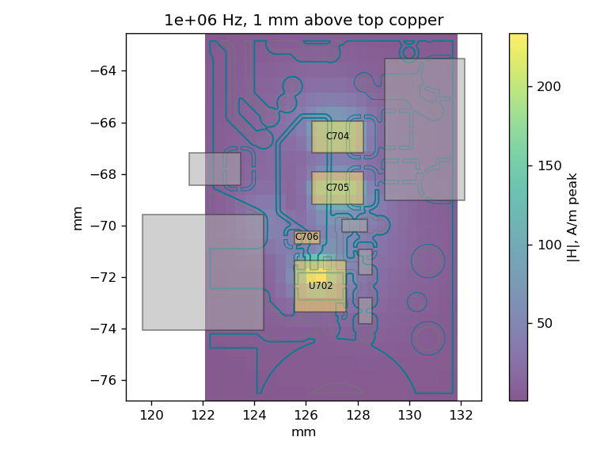
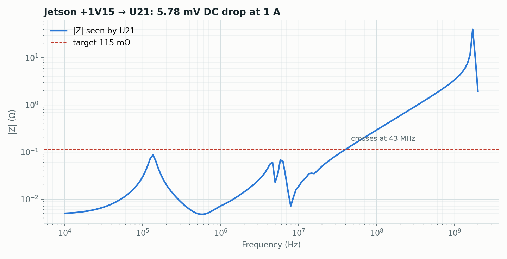
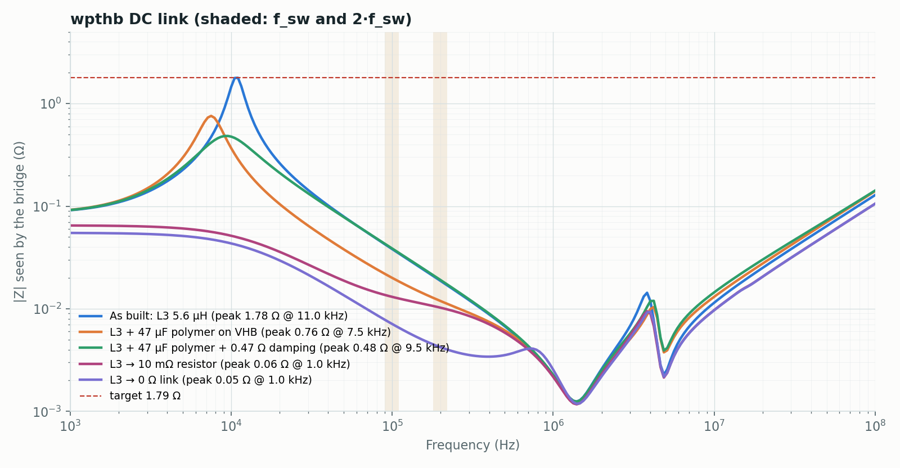
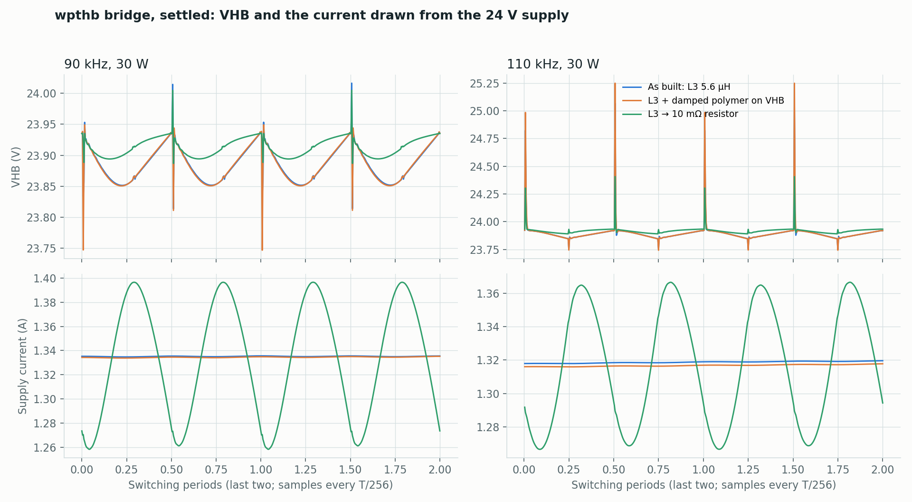

# Power checks during layout

Three tools, one question each. All read a `.kicad_pcb` (or a kicad2ems board
JSON) and run from the command line or from the kicad2ems window. Runnable
examples with their images are in
[`examples/power-workflow/`](../examples/power-workflow/README.md).

| Stage | Question | Tool | Window page |
|---|---|---|---|
| Converter placed | Is the switching loop small, and where is its field? | `python -m pcbqs.mqs` | Near field |
| Planes poured | Does each rail hold its voltage, at DC and across frequency? | `python -m pcbqs.pdn` | Power Integrity |
| Power stage routed | How do the switches, filter and load behave with this copper? | `python -m pcbqs.power_circuit` | Circuit |

[From one tool to the next](#4-from-one-tool-to-the-next): a converter found by the first
becomes a circuit, and what that circuit draws becomes the rail's load and the near
field's current.

## 1. Converter input loop (`pcbqs.mqs`)

Models the input loop only (input capacitors → switch → ground return), driven
by an assumed trapezoidal current pulse. Set `--converter` (and `--vin` when the
regulator has several supply pins), the operating point (`--fsw`, `--vin-volts`,
`--vout`, `--current`) and use `--preview` to check the meshed copper first.



- **Copper L**: the loop inductance; it sets switch-node overshoot (V ≈ L·di/dt).
  Under ~1 nH is good (CM5 U702: 1.2 nH; Jetson bucks: 0.4 nH).
- **|H| map** at 1 and 3 mm: keep sensitive traces out of the bright area.
- Use it to **compare layouts**; the pulse spectrum and ESR/ESL are assumptions,
  and the package's own inductance is excluded.

## 2. Rail DC drop and impedance (`pcbqs.pdn`)

Grows the rail from its net through series parts (sense resistors, beads, 0 Ω,
and anything in `--through`), solves DC drop on the real copper and the PDN
impedance seen by each load.



- **Drop at each load** against the tolerance budget; **hottest vias** and the
  current maps show crowding.
- **Impedance** below the target (V × ripple ÷ load step) holds the rail through
  that step. Peaks are resonances between stages; above the crossing frequency
  only the package and die help. The parts table's **mount (nH)** column shows
  which capacitors are poorly connected.
- Small rails: lower `--plane-min` (mm²). Input filters: `--through L3 --dcr L3=0.03`
  keeps the inductor's L and DCR. Bulk polymers/electrolytics: `--cap CA1=47e-6,0.02,1e-9`.
- **Loads kept with the design.** A part's `pdn.load` field (a symbol field in KiCad, which
  the board carries) is the current it draws, so a rail runs with no `--load` typed:
  `0.5`, `500m` or `2 A` from the rail the part is on; `+3V3=0.4, +1V8=100m` for a part on
  several rails; `1.5@Q2` for a load that returns through another part's ground pads.
- **A load with no pad on ground** (a bridge's high-side switch) returns through the one
  part of its kind on its other net and on ground, the low-side switch of its half bridge:
  the log and the report name it, and `--load Q1=1.5@Q4` names another. Where the board
  has no such part, or several, the return is left out and the report's first line says so.
  `--load REF=A` overrides that part's field, `--no-part-loads` ignores the fields, and the
  report names the loads that came from them.



On wpthb the input filter L3 resonates with the bridge's ceramics at 11 kHz
(1.8 Ω). A 47 µF polymer with ~0.5 Ω in series on VHB (≈ √(L/C) for that
filter) damps it to 0.5 Ω; replacing L3 with a resistor removes it but lets
the bridge's ripple current reach the supply.

## 3. Switching circuit with copper (`pcbqs.power_circuit`)

Simulates the power stage in ngspice with the copper as an extracted
multi-port model, sweeping frequency and target power. Start from
`--template` and edit components, switches and the coil/receiver.



- **Efficiency, coil currents, input power** per operating point.
- **VHB p-p** is measured at every solver step and includes switching-edge
  spikes; the plotted waveforms are sampled at T/256 and do not show them.
- **Supply current**: the ripple an input filter keeps off the supply cable
  (wpthb: 0.2–1 mA rms with L3, 35–47 mA without).
- Switch, package and capacitor parasitics in the template are placeholders;
  use datasheet or vendor models before trusting overshoot or loss.

Run time: phase-search trials use relaxed tolerances and continue from each
other; the reported run is strict. See
[power-circuit.md](power-circuit.md#run-time-and-solver-settings).

## 4. From one tool to the next

Each tool takes what the one before it found, so nothing is typed twice and nothing
that was simulated is assumed again. On CM5 Minima's U702 (5 V to 3.3 V, 1 MHz, 2 A):

```sh
# 1. the converter the near field selects, as a circuit: its capacitors and inductor from the board
python -m pcbqs.mqs CM5_MINIMA_3.kicad_pcb --converter U702 --vin-volts 5 --vout 3.3 --fsw 1e6 --current 2 --circuit > u702.json
python -m pcbqs.circuit u702.json --copper --out u702          # 94 % at a duty of 0.72
# 2. what it draws from +5V, as the rail's load and its current spectrum
python -m pcbqs.pdn CM5_MINIMA_3.kicad_pcb --rail +5V --volts 5 --source J101 --ground-source J101 \
    --load U702=1.398 --load-spectrum U702=u702/run/supply-U702.csv --out pdn_5v
# 3. the near field of that current, in place of the assumed pulse
python -m pcbqs.mqs CM5_MINIMA_3.kicad_pcb --converter U702 --spectrum u702/run/supply-U702.csv --out nearfield
```

In the window the same steps are buttons on a finished result: *Open U702 as a
circuit* on a near field's, *Copy the rail +5V and what is drawn from it to Power
integrity* and *Copy U702's input current to Near field* on a circuit's. The
question it is copied to is ticked, so Run includes it.

- **The converter as a circuit** (`--circuit`, and `circuit-model.json` in every
  near-field result): a supply on the input net, the selected input capacitors, two
  switches on the regulator's own footprint (a diode where the board has one from
  ground to the switch node), the inductor, the output capacitors within
  `--cap-radius` and a load of `vout / iout`. The duty is adjusted until the output
  is `vout`. What a board cannot say is assumed and listed in the model's
  description: 50 mΩ switches, the inductor's DCR, the voltages when the settings
  give a duty alone.
- **What a circuit draws** (`supply` in each point of `circuit.json`, and
  `supply-<part>.csv` beside it): for each supply, every part on it but its
  capacitors, with its average current and 40 harmonics (peak A and phase).
- **Ripple on the rail** (`--load-spectrum REF=FILE`): each harmonic's current
  times the impedance from that load to every other, put back together over the
  period. U702's current makes 140 mV peak to peak on +5V where it meets the
  planes (12.5 mV RMS, largest at 5 MHz) and 33 mV at U405, against 250 mV
  allowed. It is the rail's voltage, not the regulator pin's: the pin adds the
  L·di/dt of its own connection, and that loop is the near field's to solve.
- **The near field of the simulated current** (`--spectrum FILE`): the report lists
  the assumed pulse beside it. They agree where the pulse is strong (1.12 against
  1.03 A at 1 MHz) and differ fivefold at its nulls (0.03 against 0.15 A at 3 MHz):
  the settled duty is 0.72, not 0.66, and the current has the inductor's ripple.

The full bridge's runs (`pcbqs.power_circuit`) say the same of their high-side
switches, with the rail named from the supply's side and the filter's inductor on
the way (`through`, `dcr`). On wpthb at 90 kHz and 30 W, Q1 and Q2 draw 1.11 and
0.20 A on average, and their fundamentals cancel in the rail, which sees twice the
switching frequency:

```sh
python -m pcbqs.pdn wpthb.kicad_pcb --rail VIN --volts 24 --source TP2 --ground-source TP1 --through L3 --dcr L3=0.03 \
    --load Q1=1.109 --load Q2=0.198 --load-spectrum Q1=out/90kHz_30W/supply-Q1.csv --load-spectrum Q2=out/90kHz_30W/supply-Q2.csv
```

The rail's model gives 36.6 mV at 180 kHz on the bridge rail (20.8 mΩ), where the
circuit's own bus voltage has 34.7 mV (19.7 mΩ): two models of the same capacitors,
one in the frequency domain on the board's planes, one in time, within 6 %. Above
that the two differ as their capacitors' ESL and ESR do (the rail's by package, the
circuit's from its model).

The two tools' fields of the same current, peak |H| at 1 MHz over U702:

| above the copper | `pcbqs.mqs`, parts 0.5 mm up | `pcbqs.mqs`, `--part-height 0` | circuit `--fields` |
|---|---|---|---|
| 1 mm | 218 A/m | 76 A/m | 48 A/m |
| 3 mm | 12.8 A/m | 9.4 A/m | 9.6 A/m |
| 10 mm | 0.63 A/m | 0.59 A/m | 1.58 A/m |

At 1 mm the answer is what a part's body is taken to be: the near field runs each
part's current in a filament `--part-height` above its pads, the circuit's fields
are of the copper alone. At 3 mm the two agree within 6 % over the first six
harmonics. At 10 mm the circuit's field is 2.7 times larger, because it has the
inductor's ripple current in the output loop, which the input-loop model leaves out.

## Trusting the numbers

- **Mesh**: rerun with smaller `--fine`/`--dmax`. The CM5 loop moved 3–16%
  between 0.6 and 0.25 mm; refine until your margin stops moving.
- **Assumptions**: capacitor ESR/ESL, regulator R/L, switch models and operating
  points are inputs. Replace them where they decide the answer.
- **Measure** when margins are thin: VNA shunt-thru for PDN impedance, a
  near-field probe at 1–3 mm for the |H| maps.
- **Independent solvers**: [validation/](../validation/README.md) compares DC drop
  with Elmer (within 0.2–1.5% on wpthb and Jetson), loop inductance with Palace and
  FastHenry (0.3–2%), |H| with Palace (~5%) and plane pairs with Palace (≤ 0.8%).
  Copper AC resistance above ~3 MHz reads 11–34% low; treat loss figures there as
  lower bounds.

Known gaps and planned work: [power-tools-review.md](power-tools-review.md) and the
[roadmap](https://github.com/lowprocess/kicad2ems/blob/main/ROADMAP.md#power-tools-pcbqs); what was done is in [CHANGELOG.md](../CHANGELOG.md).
