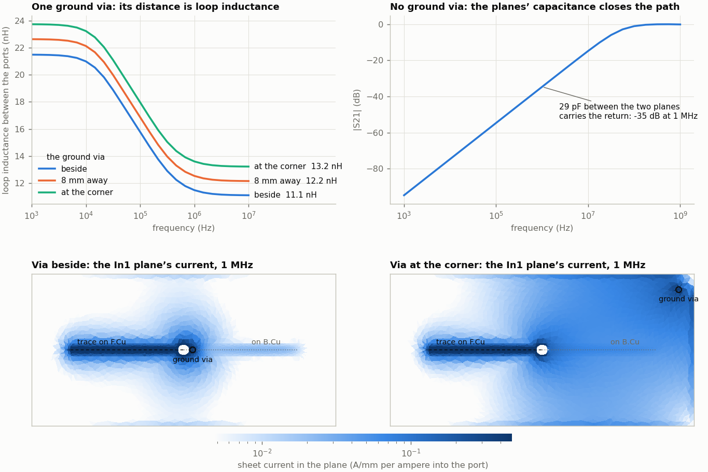

# Low-frequency S-parameters

`pcbqs.sparams` gives the S-parameters of a board's ports from the quasi-static currents of its copper, from DC
to about a tenth of a wavelength. That is the band where the full-wave solvers are at their worst (a time-domain
run needs hundreds of thousands of steps, a moment method's matrix loses its conditioning), and where the answer
is decided by where the current goes: the resistance of the copper it takes and the area of the loop it makes
with its return. A ground via missing or in the wrong place, a slot under a trace, a return that has to change
planes: each shows as loop inductance, and as impedance two ports share.

```sh
python -m pcbqs.sparams board.kicad_pcb --nets SIG,GND --fmin 1e3 --fmax 1e8 --out lf
python -m pcbqs.sparams run/board_board.json --out lf       # a kicad2ems board file: its ports as they are
kicad2ems board.toml --solvers pcbqs --fmin 0.00001 --fmax 0.1 --sweep log     # as a kicad2ems solver (GHz)
```

As a kicad2ems solver (`pcbqs`, also `qs`, `quasistatic`; installed with `kicad2ems[qs]`) it writes
`<name>_pcbqs.sNp` beside the other solvers' files and is compared with them in the report. It is run only when
named: `--solvers auto` and `all` leave it out.

## The model

Each port is as a measurement has it: a 1 A source and the port's reference impedance, both between the end of
the trace and the copper under it. One solve per driven port gives a column of S from the currents in the
terminations,

    S[j, k] = 2 I_j sqrt(z0_j / z0_k) - (j == k)        I_j: the current in port j's termination

so no impedance matrix is formed (the ports of a board without capacitance have none: nothing joins a trace to
its plane but the other ports). The copper is `pcbqs.mqs`'s: the sheet current of every layer on a triangle mesh,
the vias as filaments, and the mutual inductance of all of it. The mesh is fine at the ports' nets and within
three heights of them, where the return current lies, and coarse elsewhere.

**The board's lumped parts** (a kicad2ems board's `parts`: a resistor, an inductor or a capacitor across the
gap between its two pads) are series R, L and C between patches of the copper at the gap's two ends, as the
other solvers of kicad2ems have them, so a filter of parts or a trace with a series capacitor has its low end
too. The ports' fine mesh follows the signal through the series parts to the nets beyond them. A part with no
value, or with a pad on no copper of its layer, is left out and named (in a kicad2ems run: among its
deviations).

**Resistance and inductance** alone hold while the copper's capacitance carries next to no current: until
`π f C z0 = 0.01`, where a trace's own capacitance moves S by 0.01 (a matched line's S11 first: its capacitance
is what cancels its inductance). **Above that the charge is solved with the currents** (`pcbqs.peec`: one model
for R, L and C, in the board's dielectrics, with their loss), which holds to about a tenth of a wavelength.
Neither has radiation. `--capacitance auto` (the default) adds the charge when the band reaches above the first
limit; both limits are estimated and written with the result (`valid_to_Hz`), and a run says how many of its
frequencies are above it.

| Option | Default | |
|---|---|---|
| `--fmin`, `--fmax`, `--points` | 1 kHz, 100 MHz, 61 | the band, log-spaced (as a kicad2ems solver: the run's own frequencies, `--sweep log` for a log scale; more than 31 are solved on 31 and interpolated) |
| `--nets` | all copper | the nets to model, for a KiCad board |
| `--z0` | each port's | every port's reference impedance |
| `--dmax` | board / 25, 0.5 to 3 mm | the largest cell (`--qs-dmax`) |
| `--fine` | the narrowest port's width | the cell at the ports' nets (`--qs-fine`) |
| `--capacitance` | `auto` | `on`, `off` or `auto` (`--qs-capacitance`) |
| `--thickness` | off | the copper's two faces instead of one sheet ([below](#thickness); `--qs-thickness`) |
| `--backend` | `auto` | `dense`, or `hierarchical` (compressed) for large meshes |
| `--maps`, `--map-port` | three frequencies, the first port | the current maps; `none` for no maps |

A mesh left to the defaults is made coarser until the dense solve takes it (9,000 triangles; 5,000 with the
charge); cell sizes you give are kept.

## What it writes

- `sparams.json`: the ports, the frequencies, S, the limits, the notes, and the **path between each two ports as
  a series R and L** per frequency, `Z = -1 / Y[b, a]`: the copper's resistance and the loop's inductance with
  the return where it flows. Two ports whose copper is not joined at DC are reported as such, with the
  capacitance that closes the path when the charge is solved.
- `<name>_pcbqs.s<N>p`: Touchstone, with the port names as kicad2ems writes them.
- `sparams/exc_<port>/dump_J_<layer>_fd.npz` and `sparams_board.json`: each layer's sheet current with one port
  driven, per ampere into the port, at three frequencies of the band. kicad2ems's Viewer reads them as any run's
  field dumps: where the return goes, and how it gathers under the trace as the frequency rises.

## The return's path

`examples/return-path/return_path.py` builds a 40 × 20 mm, four-layer board: a 0.35 mm trace runs 15 mm on F.Cu
over the In1 ground plane, drops through a via and runs 15 mm on B.Cu over the In2 ground plane. The two planes
are joined by one via: beside the signal via, 8 mm away, at the board's corner, or not at all.



| Ground via | R at 1 kHz | L at 1 kHz | L at 1 MHz | L at 10 MHz |
|---|---|---|---|---|
| beside the signal via | 45.6 mΩ | 21.5 nH | 11.5 nH | 11.1 nH |
| 8 mm away | 46.3 mΩ | 22.6 nH | 12.5 nH | 12.2 nH |
| at the corner | 46.7 mΩ | 23.7 nH | 13.6 nH | 13.2 nH |
| none | not joined: no current passes with R and L alone | | | |

Each step away adds about 1 nH of loop, at every frequency: the return has to cross the plane to the via and
come back on the other one, and the maps show it doing so. The inductance falls by half between 10 kHz and 1 MHz
as the return leaves the path of least resistance (spread over the plane) for the path of least inductance
(under the trace); a model with a fixed return gets one end of that wrong. With no ground via and the charge
solved, the path is the 29 pF between the two planes: |S21| is −95 dB at 1 kHz, −35 dB at 1 MHz and −0.2 dB at
1 GHz, so a board that "works" at RF has no return at all in the audio band.

The example takes about a minute, most of it the solve with the charge.

## Checks

**A thru against a field solver and a line** (`tests/test_sparams.py`): a 1 mm microstrip, 30 mm long, 1.5 mm
over a plane.

| | pcbqs | Reference |
|---|---|---|
| R at 1 kHz | 15.57 mΩ | 14.8 mΩ, the trace alone (the plane adds the rest) |
| L at 10 MHz | 15.2 nH | 14.4 nH: a 2D field solver's 487.4 nH/m over 29.5 mm |
| L at 1 kHz | 17.3 nH | larger than at 10 MHz: the return spreads over the plane |
| a 1 × 14 mm slot in the plane across the trace | +1.7 nH (+2.0 nH at 1 kHz) | the current goes round it |
| \|S11\| at 100 MHz, with the charge | 0.064 | 0.058: the line of the field solver's L' and C' (R and L alone: 0.095) |

A mesh with the cell at the trace's width is within 2 % of one three times finer. One solve per port in turn,
the ports solved together, and the compressed matrices give the same S.

**Parts.** The thru cut at its middle and bridged by 0.5 Ω and 10 nH, with 100 pF from it to a ground pad: S is
within 0.01 of the ladder those parts make with the trace's own resistance and inductance, from 1 kHz to 10 MHz.
kicad2ems's low-pass filter (two 8.2 nH inductors, 6.8 pF to ground: `demo_lowpass`) against mom25d solved at
each frequency: |S21| 0.9915 for 0.9917 at 50 MHz, 0.9910 for 0.9912 at 117 MHz, 0.9886 for 0.9882 at 274 MHz,
and 0.870 for 0.856 at 640 MHz, near where the estimate says it stops holding (830 MHz). Without the parts the
two inductors' gaps are open and nothing gets through.

**Against the full-wave solvers** where both hold, 0.05 to 1 GHz, as rms |ΔS| over the terms each computed
(complex, so phase counts):

| Board | pcbqs from gfdtd, up to 0.2 / 0.5 / 1 GHz | mom25d from gfdtd | Line model from gfdtd | Time: pcbqs, mom25d, gfdtd |
|---|---|---|---|---|
| `demo_transition`: a microstrip through a via to a stripline | 0.008 / 0.016 / 0.029 | 0.006 / 0.007 / 0.011 | 0.003 / 0.005 / 0.009 | 33 s, 9 s, 23 s a port |
| `rf_diffvia`: a differential pair through two vias (mixed-mode terms) | 0.006 / 0.012 / 0.021 | 0.004 / 0.005 / 0.009 | 0.004 / 0.006 / 0.011 | 33 s, 23 s, 21 s a port |
| `rf_diffvia` with its four return vias taken out | 0.017 / 0.015 / 0.022 | 0.023 / 0.021 / 0.018 | 0.39 / 0.30 / 0.22 | 33 s, 51 s, 20 s a port |

For scale, 0.02 is about 0.17 dB on a through path. kicad2ems's examples, 24 mm long, with the default mesh and
the charge solved (the band is above the first limit); pcbqs's own estimate of where it holds is 714 and 594 MHz.
What is left above 200 MHz is the copper's thickness ([below](#thickness)).

The last row is the case the solver is for. With no via between the plane the microstrip runs over and the plane
under the stripline, the pair's differential mode is untouched (−0.04 dB) and its common mode has no return but
the planes' capacitance:

| \|Scc21\| | 50 MHz | 150 MHz | 300 MHz | 500 MHz | 1 GHz |
|---|---|---|---|---|---|
| gfdtd | −11.1 dB | −3.7 dB | −1.2 dB | −0.33 dB | −0.10 dB |
| pcbqs | −11.0 dB | −3.5 dB | −1.0 dB | −0.31 dB | −0.14 dB |
| mom25d | −10.3 dB | −3.1 dB | −0.9 dB | −0.25 dB | −0.11 dB |
| line model | −0.01 dB | −0.02 dB | −0.04 dB | −0.07 dB | −0.17 dB |

The line model follows the traces and never sees it. Below 50 MHz the full-wave solvers get slow (136,000 time
steps for gfdtd here) while this one goes on down to DC.

<a id="thickness"></a>
## Copper thickness

By default the copper is one sheet with its DC resistance. That is exact at the low end, and the lightest
model, but it leaves two things out that show at the top of the band:

- **The skin effect.** At 100 MHz the current of 35 µm copper is in its faces (a skin depth of 6.6 µm): the
  thru's resistance is 45.9 mΩ, where one sheet keeps 16.4 mΩ.
- **A narrow trace's impedance.** A sheet's inductance is a few percent high and its capacitance low for a trace
  not much wider than it is thick, so a matched line's S11 reads high.

`--thickness` models each layer's copper as two sheets at its faces, joined through the copper by the slab's
impedance (`MQS(conductor_loss='slab')`, [quasistatic.md](quasistatic.md#two-face-sheets-experimental)). It
doubles the unknowns and needs a cell no wider than the trace to pay off:

| `demo_transition`: 0.35 mm microstrip, a via, 0.15 mm stripline | One sheet, default mesh | Two faces, `--fine 0.15 --dmax 1.3` |
|---|---|---|
| \|S11\| at 500 MHz (gfdtd −30.4 dB, the line model −29.3 dB, mom25d −27.3 dB) | −23.7 dB | −29.5 dB |
| rms \|ΔS\| from gfdtd up to 0.2 / 0.5 / 1 GHz (mom25d from gfdtd: 0.006 / 0.007 / 0.011) | 0.008 / 0.016 / 0.029 | 0.004 / 0.005 / 0.010 |
| Triangles, time for 20 frequencies with the charge | 3,748, 33 s | 15,276, 8 min |

With the faces and a cell at the trace's width the quasi-static answer is as close to gfdtd as mom25d is, to
1 GHz on a 24 mm board; as one sheet it is that close to 200 MHz, and reads a matched line's S11 3 to 6 dB high
above that. The low end, which is what the solver is for, is the same in both.

## Limits

- No radiation and no resonance of the board itself: quasi-static, to about a tenth of a wavelength.
- Ports between a trace and the copper under it only (no gap ports); differential pairs as their legs, the modes
  made from them.
- A part is its value alone, between its pads: no body, and no coupling of its own field to the copper.
- The limits are estimates: the capacitance of each piece of the ports' nets as a line over the copper nearest
  above and below (parallel plates and Wheeler's fringe; 2.2 pF for the thru, whose line has 2.05 pF).
- With the charge the system is dense and larger: a few seconds a frequency at 4,000 triangles.
