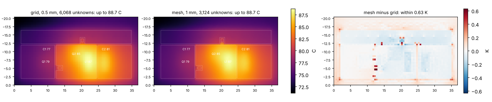

# Temperature (`pcbqs.thermal`)

A trial of a lightweight thermal solver inside pcbqs: the steady temperature of a board from what its parts
dissipate, in a fraction of a second, with two discretisations of one model to compare. The 3D reference remains
Elmer through kicad2ems-fem, and the two agree within 2 K on eleven boards (below).

    python -m pcbqs.thermal board.kicad_pcb --loss Q1=0.35 --loss D1=0.5
    python -m pcbqs.thermal --circuit circuit-results               # the board and losses of a circuit run
    python -m pcbqs.thermal --circuit circuit-results --method both # grid and mesh, with their difference
    python -m pcbqs.thermal board.kicad_pcb --loss U1=1.2 --theta U1=8 --film 12 --ambient 40
    python -m pcbqs.thermal board.kicad_pcb --loss Q1=0.35 --film-edge 0  # the edges insulated

In kicad2ems-gui it is the **Thermal** analysis (`pcbqs.analyses.Thermal`, a kicad2ems analysis plugin): its form
is its options table, and with no losses typed it takes the latest circuit run's, on that run's board.

It writes `thermal.json` (each part's temperature, each layer's hottest and mean, heat in and out, the board and
the circuit case they came from),
`thermal.npz` (the maps) and `thermal.png`; with `--method both` a picture per solver and
`thermal-compare.png`. The maps also go where kicad2ems's viewer reads a run's (`thermal/viewer.py`):
`thermal_board.json` and, under `thermal/exc_board/`, each layer's temperature as a field dump in °C (NaN off the
board; with both solvers each one's, and mesh minus grid in K), so the Viewer turns, cuts and probes them in 2D and
3D on a colour scale from the board's coolest point to its hottest. The report (`reports.thermal_report`: the
parts' and the layers' tables) is on its Report and Tables pages.



## The model

The board is a stack of sheets, one per copper layer (`problem.py`):

- **Along the board** a sheet conducts through its copper (390 W/m/K x its thickness, where there is copper) and
  its share of the laminate (0.8 W/m/K; half of the dielectric on each side of it).
- **Between sheets** heat crosses the dielectric (0.3 W/m/K over its thickness, per area) and the vias (each a
  plated barrel, 25 um).
- **To the air** the two outer sheets lose heat through a film coefficient, convection and radiation together
  (10 W/m2/K a face unless told otherwise; `--film`, `--film-bottom`), to the ambient (25 C; `--ambient`).
- **At the edges** (the outline and its cut-outs) every sheet loses heat over the height of the board it stands
  for, its share of the laminate, so the edges are the board's whole thickness high. Their coefficient is the
  mean of the faces' unless told otherwise (`--film-edge`; 0 insulates them). On a small board they matter: on
  the demo boards (17 to 62 mm across) they carry 6 to 15 % of the heat and lower every rise by 4 to 13 %.
- **Heat comes in** over the pads of the parts that dissipate: each part's loss, shared over its pads by area.
- **A part's temperature** is the mean temperature of the copper under its pads, plus its loss times its
  `--theta` (K/W from its pads to the part itself), when one is given.

It is the DC drop's equation with thermal conductivities and a sink over the whole face, and it is linear: one
sparse solve.

`--circuit FOLDER` takes the board and the losses from a circuit run (`python -m pcbqs.circuit`): every part's
average power, summed per footprint (a transformer's windings net to its loss). A source and a load are not on
the board, nor is a part bound to a connector, and each is said.

In code:

```python
from pcbqs.thermal import Problem, solve
p = Problem.of(board, {'Q1': 0.35, 'D1': 0.5}, film=10.0, theta={'Q1': 2.0})
p.edge_film                                         # W/m2/K at the edges: the faces' mean (edge_film=0: none)
p.heat('shunt', [('F.Cu', polygon)], 0.2)           # heat over any area of a layer
r = solve(p, 'grid', 0.5)                           # or 'mesh', 1.0
r.parts['Q1']                                       # dict(power_W, board_C, part_C)
r.out_W, r.edge_W                                   # the heat given off, and of it through the edges
r.T                                                 # grid: (layers, ny, nx) C; mesh: (layers, vertices), r.nodes, r.tris
r.sample('F.Cu', x, y)                              # either, at points (mm)
```

`sample` is the solution's own interpolation: between cell centres on the grid, and on the mesh's own triangles
(NaN off the board, and in its holes).

## The two solvers

**Grid** (`grid.py`): square cells over the outline's bounding box, one unknown per cell on the board per layer
(finite volumes). The copper of each layer is put on a raster much finer than the cells (1/16 mm; exact in
area), and the conductance between two neighbouring cells is worked out on that raster: between their centres
each fine row is a chain in series, the rows in parallel. So a gap narrower than a cell still holds heat back, a
trace narrower than a cell still carries it, a slot in the board still parts it, and nothing follows the outline
of the copper: the number of unknowns depends on the board's area and layer count only.

**Mesh** (`mesh.py`): pcbqs's triangle mesher (the one the DC drop uses), linear elements. One mesh of the
board's outline carries every layer: the outlines of each layer's copper, of the heated pads and a ring at each
via are made mesh edges, so the layers share their vertices. It follows the copper exactly, and pays for it: the
mesh has to resolve every outline of every layer at once.

## What the trial found

Both against the exact solution for a heated disc on a two-layer plate (the sum and the difference of the two
layers each obey a screened Poisson equation; 1 W over 10 mm, 15 K rise at the centre):

| | size | unknowns | worst error | time |
|---|---|---|---|---|
| grid | 1 mm | 28,800 | 0.06 K | 0.6 s |
| grid | 0.5 mm | 115,200 | under 0.05 K | 1.4 s |
| mesh | 2 mm | 12,000 | 0.13 K | 0.2 s |
| mesh | 1 mm | 45,710 | under 0.05 K | 1.2 s |

(0.04 K of what is left is the plate's edge, which the exact solution does not have.) A face heated all over
gives the exact uniform temperatures on both to 1e-6 K, and the heat leaving through the films equals the heat
put in.

On the ten demo boards, with the losses of their circuit runs (0.006 to 1.26 W, rises of 1 to 62 K), every
part's temperature against the mesh at 0.25 mm:

| | size | worst part, any board | all ten boards |
|---|---|---|---|
| grid | 2 mm | 1.1 K | 0.5 s |
| grid | 1 mm | 0.2 K | 0.3 s |
| grid | 0.5 mm | 0.25 K | 0.6 s |
| mesh | 2 mm | 0.8 K | 0.4 s |
| mesh | 1 mm | 0.3 K | 0.5 s |
| mesh | 0.5 mm | 0.1 K | 1.7 s |

On boards this simple the two are the same solver for practical purposes. They part on a dense board. One made
in code (100 x 80 mm, four layers, 500 routed traces, a ground plane and a split power plane with 227
clearances each, 400 vias, eight parts, 3.75 W):

| | size | unknowns | time | memory | hottest part |
|---|---|---|---|---|---|
| grid | 1 mm | 32,000 | 0.9 s | | 59.1 C |
| grid | 0.5 mm | 128,000 | 3.3 s | 0.5 GB | 59.5 C |
| grid | 0.25 mm | 512,000 | 27 s | | 59.5 C |
| mesh | 2 mm | 1,572,116 | 53 s | 4.1 GB | 58.8 C |
| mesh | 1 mm | 1,985,092 | 91 s | | 59.1 C |

The mesh cannot be coarse there: 1.5 million unknowns are spent on following outlines before any are spent on
the temperature, and it is still converging from below at 2 million. The grid at 0.5 mm is within 0.1 K of its
own answer at 0.25 mm.

So the grid is the one to take forward, and it is the default: its cost does not depend on the copper, it needs
no mesher, and its maps are images. The mesh stays as the check on it.

Two things the trial turned up in the grid, both fixed and tested: a board that ends inside a cell lost that
cell's conduction to its neighbour (the whole board read 1 K hot), and a drawn raster made thin traces a
quarter wider than they are (the raster is now exact in area).

The grid-mesh tables above were taken before the edges lost heat; both solvers take the edges the same way.

## Against Elmer

`validation/thermal_elmer.py` runs each demo circuit and gives its lossiest case's part losses to the grid
(0.5 mm), the mesh (0.5 mm) and Elmer through kicad2ems-fem (`elmer/thermal.py`: 3D conduction in the copper,
the barrels and an anisotropic laminate, wedge elements, the same film on every exposed face), with the same
film, ambient and conductivities. Each part's temperature is the mean under its pads in all three.

| | parts | worst part | within 1 K | grid time | Elmer time |
|---|---|---|---|---|---|
| ten demo boards, 2 layers, 0.006-1.26 W | 48 | 2.0 K, 4.5 % of its rise (05 C1); 5.5 % at most (09 C1) | 43 of 48 | 0.02-0.09 s | 0.5-1.5 s |
| wpthb, 4 layers, Q1 Q2 L3 1 W | 3 | 0.9 K, 3.1 % (L3) | 3 of 3 | 0.4 s | 12 s |

Both are converged: from 1 to 0.125 mm the grid moves under 0.2 K, and from 30,000 to 330,000 wedges Elmer
moves under 0.2 K. The grid and the mesh agree within 0.2 K on the demo boards (0.9 K on wpthb's L3).

Two things the comparison found:

- **The edges.** Before they lost heat here, every part read 4.5 K hot of Elmer on the 04 buck, a tenth of the
  rise on every board alike: Elmer's film covers the board's edges, and on a board 20 by 37 mm they give off a
  tenth of the heat. With the edges in, that offset is gone.
- **What is left is the laminate, not the mesh.** The hottest parts read up to 2 K (5 %) low and the coolest up
  to 2 K high: the sheets spread heat a little more than the 3D board does. Its in-plane conduction is put on
  the copper sheets at their temperatures, which near a hot pad overstates it (in the 3D board the laminate
  between the layers is cooler than the copper on top). With the laminate's in-plane conductivity set to zero
  in both, the difference turns into a near-uniform +0.5 to +1 K. Copper at 385 against 390 W/m/K accounts
  for 0.05 K.

## What it does not do yet

- **The parts' own cooling.** A part's body gives heat to the air itself; here all of it goes into the board.
  It reads high for parts that stand tall (inductors, electrolytics).
- **The film is one number.** Natural convection and radiation both grow with the temperature rise, and the
  air warmed by one part reaches the next. A film that depends on the temperature is a few repeats of the same
  solve.
- **The copper's own loss** is not put in as a map. From the DC drop it is a loss per triangle; on the demo
  boards it is milliwatts.
- **Resistance against temperature**: copper's resistivity rises 0.39 % per K, which feeds back into the DC
  drop and the circuit's losses.
- **Fixed-temperature points** (a chassis screw, a heatsink) and time (a thermal step) are not in.
- **The laminate between the sheets.** Its in-plane conduction sits on the sheets (above); one more sheet per
  dielectric, at mid-thickness, would follow the 3D board more closely near hot parts, for 2L-1 unknowns per
  cell instead of L.
- Large grids want a multigrid solve; a direct one is used (about 3 s at 128,000 unknowns on four layers).
