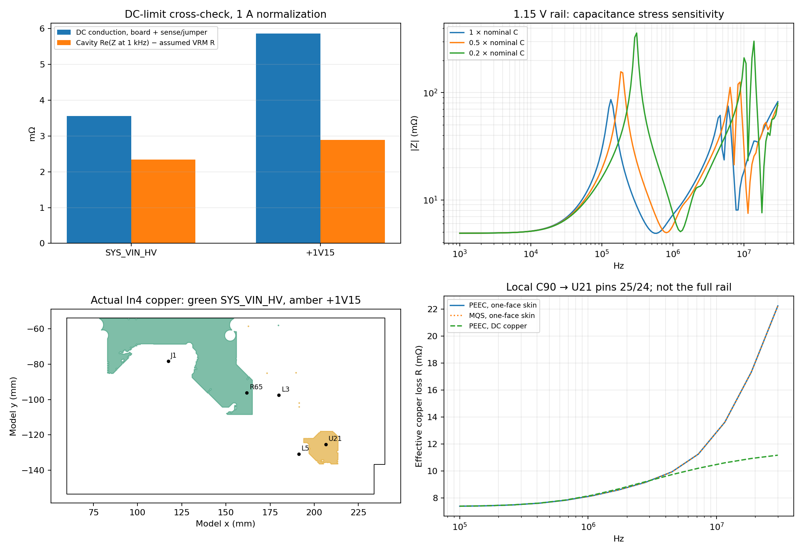

# Jetson AGX Thor baseboard: PDN check

Checked the KiCad Jetson AGX Thor example, including a full-board DC cross-check of the module supply and USB-hub supply, selected cavity PDN observations across all eight buck outputs, and a bounded local PEEC/skin trial. **This is a model check, not a hardware power-integrity sign-off.**

## Main findings

1. The routed module and USB-hub supply paths are connected and have finite DC resistance. No hardware open-circuit conclusion follows from the rejected cavity outputs described below.
2. The current cavity PDN path understates the DC limit on the two detailed checks, despite relatively small body-mesh changes. Its pad/via access treatment needs attention before treating its absolute impedance as validated.
3. In the valid local capacitor loop, PEEC and MQS with the same skin model agree to 0.0046%, while omitting skin loss almost halves the predicted copper loss resistance at 30 MHz.
4. Whole-rail PEEC is not practical with the present dense implementation in this environment: even a cropped 1.15 V rail has 25,529 triangles. Four float64 triangle-moment matrices alone need 20.9 GB (19.4 GiB), before other matrices/factors; the environment has an 8 GiB limit.

## Full-board DC checks

Each load draws 1 A at its actual supply pads and returns through its ground pads. DC begins at the output inductor and returns to the named regulator ground pads. The DC values include the sense resistor/jumper and routed power/ground, but exclude the regulator output impedance and the module/package internals.

| Path | Power-side drop at 1 A | Ground rise at 1 A | Total board-path R | 3 → 2 mm mesh change |
|---|---:|---:|---:|---:|
| SYS_VIN_HV → J1 | 3.271 mV | 0.290 mV | 3.561 mΩ | 0.68% |
| +1V15 → U21 | 5.293 mV | 0.568 mV | 5.861 mΩ | 1.37% |

The module path is U11 → L3 → `/DCDC/16V_OUT` → **R65, 1 mΩ** → `SYS_VIN_HV` → J1. R65 accounts for approximately 1.000 mV of the 1 A drop. The USB-hub path is U69 → L5 → R7 → `+1V15` → U21; the idealized 0 Ω R7 is represented as 10 µΩ by the rail model.

Using the schematic’s 9.5 A label as an illustrative DC module current, the linear model gives about **33.8 mV drop** and **0.32 W board-path loss**. This is a scaling calculation, not a measured load condition or a thermal prediction. The full-board DC ground meshes contain about 0.53–0.56 million vertices.

## Cavity PDN versus its DC limit

The AC trial uses an explicit **2 mΩ + 20 nH** regulator impedance, not a measured control-loop model. Accordingly, the appropriate low-frequency reference is the DC board resistance plus 2 mΩ.

| Rail | DC board R + assumed VRM R | Cavity Re(Z), 1 kHz | Difference |
|---|---:|---:|---:|
| SYS_VIN_HV | 5.561 mΩ | 4.342 mΩ | -21.9% |
| +1V15 | 7.861 mΩ | 4.886 mΩ | -37.8% |

After subtracting the assumed VRM resistance, the inferred cavity board resistance is lower than DC by **34.2% for SYS_VIN_HV** and **50.8% for +1V15**. This is a DC-limit consistency check, not a comparison against measured hardware.

The cavity implementation represents mounting/access paths principally as inductances; its connection data carry `L_path` and its impedance assembly adds `jωL`, rather than the complete access-path resistance obtained from a conduction solve. Its port grouping also differs from the full DC network. Those are concrete model differences to resolve; mesh agreement alone does not remove them.

The default plane-area cutoff is about 1,800 mm² on this board. It is used for the large rails. The small 1.15 V rail’s largest power pour is about 255 mm², so a documented 50 mm² cutoff is needed for this diagnostic. Lowering that cutoff indiscriminately produced spurious isolated-domain responses on other rails; the original 50 mm² sweep is retained only as a rejected diagnostic.

## Broad AC survey

Values below are uncalibrated model observations at selected ports. The large-rail meshes use the default plane cutoff; small rails use 50 mm². Except for SYS_VIN_HV and +1V15, these are single-body-mesh observations, not convergence studies.

| Rail | Observations | Re(Z) at 1 kHz including assumed VRM | Interpretation |
|---|---|---|---|
| SYS_VIN_HV | J1 | 4.342 mΩ | Finite; DC limit is underestimated |
| +1V15 | U21 | 4.886 mΩ | Finite; DC limit is underestimated |
| +5V | U69, U7, U30 | 3.996, 4.825, 4.753 mΩ | Preliminary model observations |
| +3V3 | U21, J12 | 3.872, 4.266 mΩ | Preliminary model observations; M.2 branch not assessed |
| +1V8 | U43 | 10.539 mΩ | Preliminary; U78 response rejected as a usable whole-rail result |
| +5V_AON | U15, U70 | 3.000 mΩ each | Same lumped-node result; does not resolve their separate routing losses |
| +20V | U63, U64 | 36.649, 2.301 mΩ | Small-pour diagnostic only; topology/reference treatment needs checking |
| +12V | TP98 | Not accepted | No active IC load selected; probe response is not a usable rail result |

The 1.8 V U78 result has |Z| ≈ 1.59 kΩ at 1 kHz; the 12 V TP98 result is ≈ 838 MΩ. Separate power-only DC solves find finite paths (about 9.0 mΩ and 0.676 Ω respectively). These results are not evidence that the hardware rails are open. They indicate that the cavity port/domain construction cannot be accepted blindly for these observations. The TP98 value is a test-point connection check, not a suggested 1 A operating load.

The original direct-net observation filter excluded J13’s `/M.2/3V3_M2` power pins. No J13 impedance is reported. Portable rerun scripts retain that named branch, but the result for it has not been recomputed.

## Capacitance/VRM assumptions matter

The 1.15 V rail has 13 nominal decaps totaling 67 µF. Under the assumed 20 nH VRM model, its modeled antiresonance is near 134 kHz. Uniform capacitance scaling gives:

| Capacitance scale | Sampled peak | Peak frequency |
|---|---:|---:|
| 1 × | 86.2 mΩ | 133.9 kHz |
| 0.5 × | 156.7 mΩ | 184.7 kHz |
| 0.2 × | 359.6 mΩ | 309.3 kHz |

This is a stress sensitivity, not a claim that the actual capacitors lose 50–80% of their capacitance. Manufacturer bias/tolerance data and the actual regulator impedance are needed before using those peaks for hardware pass/fail.

## Local PEEC and skin check on actual copper

The bounded test uses C90 (100 nF) and U21 pins 25 (+1V15) / 24 (GND), all ten actual copper layers, and the layered dielectric stack. It assumes 5 mΩ capacitor ESR, 0.35 nH package ESL and a one-face skin slab. This is a single capacitor mounting loop, not the full 1.15 V PDN. Its ESR assumption is explicitly 5 mΩ; the broad cavity run uses the existing package/default component rules.

| At 30 MHz | PEEC + skin | PEEC + DC copper |
|---|---:|---:|
| Effective copper loss resistance | 22.232 mΩ | 11.160 mΩ |

Skin raises that copper resistance by **1.99×**. PEEC and MQS with the same skin model differ by at most **0.00451%** over 100 kHz–30 MHz. The explicit 100 nF component dominates this local loop’s capacitance; adding surface charge changes little here.

The accepted 0.6 mm-margin crop has 1,439 triangles and an intact intended return loop. Increasing the margin from 1.0 to 1.5 mm changes the three checked complex impedances by up to **1.50%**; refining body spacing from 1.0 to 0.5 mm at fixed crop changes them by up to **6.02%**. Thus this is a useful loss-model discriminator, not a precision accuracy claim.

The smaller 0.3 mm-margin crop cuts the intended loop. PEEC can still solve displacement current between the resulting islands, but that finite answer is not a valid representation of the intended connected mounting loop. Its outputs are explicitly rejected. The topology precheck in the rerun script prevents that mistake.

## What changed and what to do next

- Added resistive series links to the experimental PEEC PDN adapter, preserving their explicit/package ESL, and an optional pre-fill triangle limit. Beads remain unsupported. Sixteen focused PDN tests pass, including a known series-resistor DC check.
- The production PDN CLI/default was not changed.
- Before relying on cavity absolute impedance, validate each observation against the DC path and diagnose isolated plane domains. Include/access-calibrate the missing resistive path contributions and review actual supply-pin grouping.
- Before full-board PEEC, the dense storage/solve and ten-layer dielectric-image costs need work. The 25,529-triangle cropped rail already exceeds this environment’s memory budget before solving.
- Validate the regulator model and capacitor effective values before interpreting modeled antiresonance as a hardware failure. No measurements or independent full-wave reference were available in this check.

## Source and reproduction

Source: [KiCad Jetson AGX Thor example](https://github.com/KiCad/kicad-source-mirror/tree/8c85ac14529b4375d75f2bb3d0e97e6145b0a32c/demos/jetson-agx-thor-baseboard), Antmicro, Apache-2.0. Board blob `2884cd5276b0676d4e5d8d919f202d85e8432987` was verified against the download. The original board is about 85 MB and is not copied into this report directory. See `SOURCE-LICENSE` and `results/provenance.json`.

[Setup and rerun instructions](README.md). Raw numeric results, model assumptions, source hashes, crop checks and rejected diagnostics are under `results/`. The portable scripts are under `scripts/`.
