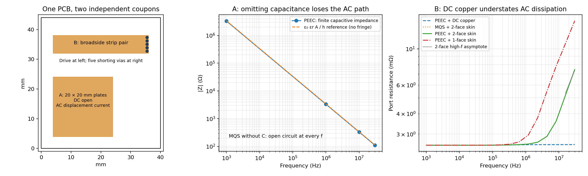

# PEEC and skin-effect test PCB

A 40 × 44 mm, two-layer board with two independent test coupons. It demonstrates
two different failures of simpler models, with numerical comparisons and
independent closed-form references. It is a simulation example with a KiCad
layout; the results have not been measured on fabricated hardware.



## What the board demonstrates

**A: displacement current through a PCB capacitor.** Two 20 × 20 mm copper
plates overlap across a 0.300 mm dielectric, with no galvanic connection.
The only capacitance is extracted from the geometry; no lumped capacitor is
inserted into the solver. PEEC gives **48.20 pF**, compared with **47.22 pF**
from ε₀ εr A/h, which excludes edge fringing. At 1 MHz, the impedance is about
**−j3.30 kΩ**. A magnetic-only MQS model correctly refuses this topology because
it has no conduction loop; treating that model as an AC open circuit is the
wrong prediction for this coupon.

For an illustrative external circuit, drive one plate with an ideal voltage
source and connect the other to the source return through 1 kΩ. The computed
voltage transfer across that resistor is **0.290 at 1 MHz**. A model omitting
geometrical capacitance predicts zero. Thus a requirement such as “coupling must
remain below 0.2” gets the wrong pass/fail answer. The resistor is an external
load used in postprocessing, not a populated component on the PCB.

**B: AC copper loss in a shorted strip pair.** Two 32 × 6 mm strips overlap on
opposite layers. Five 0.6 mm finished-diameter plated holes short their far ends.
Apply a differential current between the exposed top and bottom contacts at the
near end. Copper is 70 µm thick; at 30 MHz its skin depth is **12.1 µm**.

| Model at 30 MHz | Port resistance | Loss at 1 A RMS |
|---|---:|---:|
| PEEC, DC sheet resistance | 2.585 mΩ | 2.585 mW |
| PEEC, two-face skin slab | 7.468 mΩ | 7.468 mW |
| PEEC, one-face skin slab | 14.866 mΩ | 14.866 mW |

Even the two-face case raises loss by **2.89×**. For an illustrative 5 mW loss
budget at 1 A RMS, the DC-copper model passes and both skin models fail.
The low-frequency strip reference, 2l/(σwt), is 2.545 mΩ. The independent
two-face high-frequency reference, 2l/(2wσδ), gives 7.383 mΩ at 30 MHz.
The extracted values differ by 0.63% and 1.14%, respectively; end spreading,
via resistance and finite-frequency effects are omitted from these formulas.
Here l = 31 mm is the approximate distance between contact/short centres.

The comparison also runs MQS with skin loss: its impedance differs from PEEC
with the same loss model by at most **0.053%** over the sweep. Capacitance matters
critically for A, while skin loss is the material omission for B. PEEC alone does
not imply that skin effect is enabled.

## Reproduce

From the pcbqs repository, with its dependencies installed:

```sh
PYTHONPATH=src OPENBLAS_NUM_THREADS=1 python tools/peec_skin_demo.py \
    --out examples/peec-skin/results --workers 2
```

The default spacings are 3, 2 and 1.5 mm. The script runs five model variants,
checks real-power balance and charge continuity, compares against independent
references, and exits unsuccessfully if the demonstration or mesh checks fail.
It uses the optional OpenMP backend when available, with CPU fallbacks otherwise.
The script itself does not import kicad2ems or require ngspice.

The last refinement changed capacitance by **0.050%** and the two-face 30 MHz
resistance by **0.265%**. The maximum charge-continuity residual was below
2 × 10⁻¹⁵ A for a 1 A peak source. The CSV contains R and X at 17 frequencies
from 1 kHz to 30 MHz; JSON also records every mesh, reference, setting and check.

Files:

- `results/peec-skin.kicad_pcb`: openable KiCad layout, including filled zones,
  exposed contacts, stackup and shorting vias.
- `results/board.json`: equivalent geometry for pcbqs, in mm with y up.
- `results/comparison.png`: layout and ablation plots.
- `results/summary.json`: full results and automatic checks.
- `results/impedance.csv`: strip-pair impedance for each model.
- `results/gerbers/`: copper, mask, silk, outline and drill exports from KiCad 9.
- `results/drc.txt`: KiCad DRC report.

The KiCad file was parsed both by KiCad 9 and kicad2ems. Its copper polygons,
nets, dielectric and copper thicknesses, and via locations match the JSON.
KiCad reports zero DRC violations and zero unconnected items under its default
rules. A fabricator still needs the specified stackup and material parameters.

## Physical assumptions and measurement

The laminate is specified as εr = 4, tan δ = 0.002; copper conductivity is
5.8 × 10⁷ S/m and via plating is assumed to be 25 µm. There are no populated
components. Measure A across `CAP_TOP` / `CAP_BOTTOM`, and B across `LOOP_TOP` /
`LOOP_BOTTOM`, using a calibrated, deembedded impedance fixture. The strip test
requires resolving milliohms in series with an inductive reactance. The quoted
power values are normalized calculations, not thermal measurements.

Each coupon is solved independently, excluding the other coupon's copper.
Fixture, inter-coupon coupling, cables, connector loss, solder mask dielectric,
roughness and radiation are not included. The 40 mm board is about 0.008
wavelengths across in an εr = 4 material at 30 MHz, supporting the quasistatic
assumption. Thin copper sheets sit at dielectric interfaces; thickness is used
in the conductor impedance, not resolved as a three-dimensional volume.

The one-face slab assumes zero field on the other face; the two-face slab
assumes equal current sharing. They expose sensitivity to through-thickness
proximity assumptions and are **not rigorous error bounds**. Lateral current
redistribution is solved; arbitrary through-thickness proximity current and via
skin effect are not. Mesh agreement and these analytic limits support the
demonstration but do not replace hardware or independent full-wave validation.
