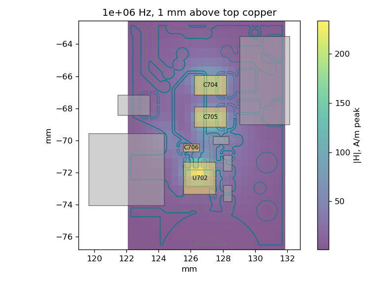
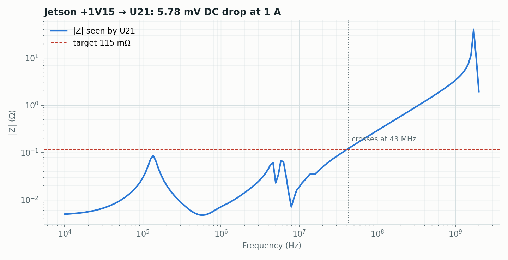
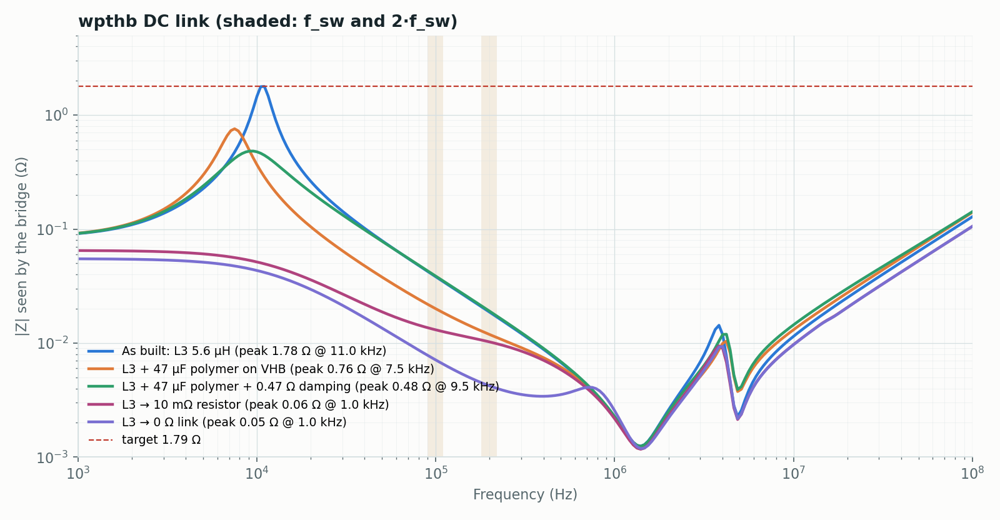
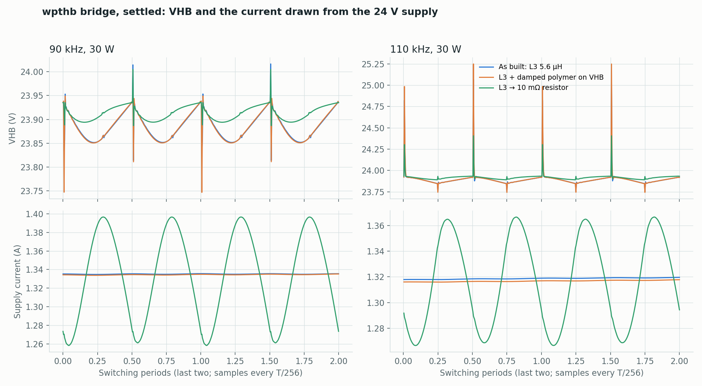
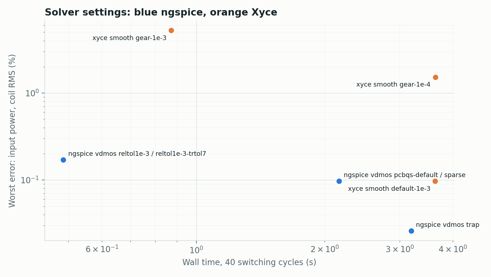
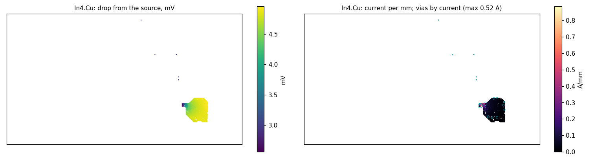

# Power-workflow examples

Five small scripts, one per question in [docs/power-workflow.md](../../docs/power-workflow.md).
Each drives the public command-line tools and writes its images to `images/`.

| Script | Board | Shows | Time |
|---|---|---|---|
| `01_converter_near_field.py` | CM5 Minima (KiCad demo) | U702 input loop: copper L, \|H\| at 1/3 mm, spectrum | ~15 s |
| `02_rail_pdn.py` | Jetson AGX Thor (KiCad demo) | +1V15 → U21: DC drop, maps, impedance | ~70 s |
| `03_dc_link_variants.py` | wpthb | DC-link impedance: filter as built, damped, bypassed | ~30 s |
| `04_switching_circuit.py` | wpthb | Bridge + copper + coil: VHB and supply current, three builds | ~6 min |
| `05_solver_benchmark.py` | built in | ngspice/Xyce settings: time against error | ~1 min |

```sh
export PYTHONPATH=src:../kicad2ems/src           # from the pcbqs root, or pip install pcbqs kicad2ems
python examples/power-workflow/01_converter_near_field.py
```

Inputs are not redistributed here:

| Variable | Default | Needed by |
|---|---|---|
| `KICAD_DEMOS` | `/usr/share/kicad/demos` | 01, 02 (KiCad's `cm5_minima` and `jetson-agx-thor-baseboard`) |
| `WPTHB_BOARD` | `~/Desktop/wpthb/wpthb.kicad_pcb` | 03, 04 |
| `POWER_WORKFLOW_OUT` | `examples/power-workflow/out` | all (run folders) |

04 needs ngspice; 05 also uses Xyce when installed. Operating points, ESR/ESL,
regulator and switch models are stated in each script and are assumptions, not
board data.

## Images

| | |
|---|---|
|  |  |
| CM5 U702 \|H\| 1 mm above the board, 1 MHz | Jetson +1V15 impedance at U21 |
|  |  |
| wpthb DC link, five variants | wpthb bridge waveforms, three builds |
|  |  |
| Circuit-solver settings | +1V15 DC drop and current, In4.Cu |
