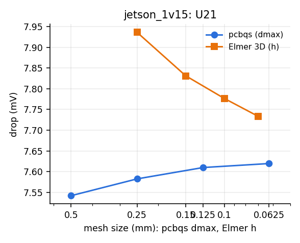
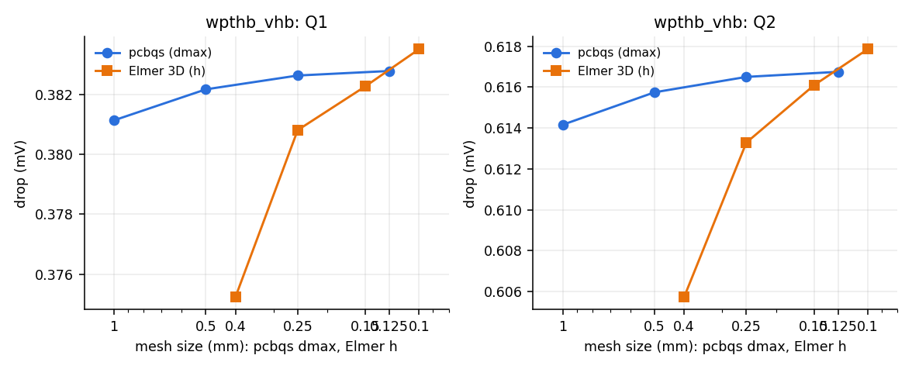
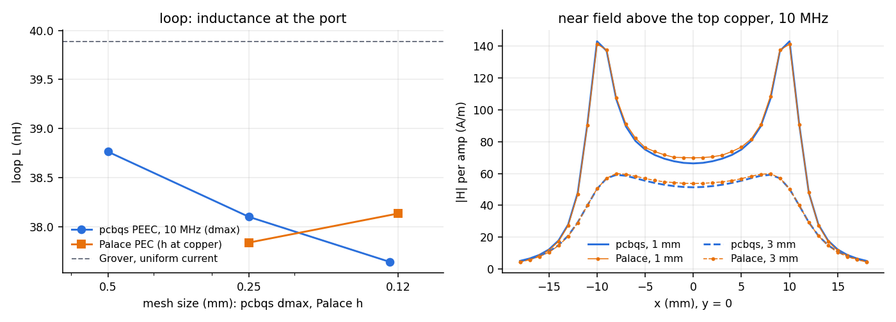
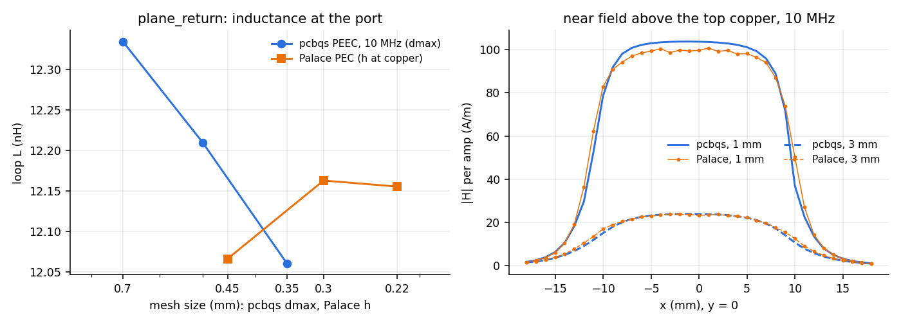
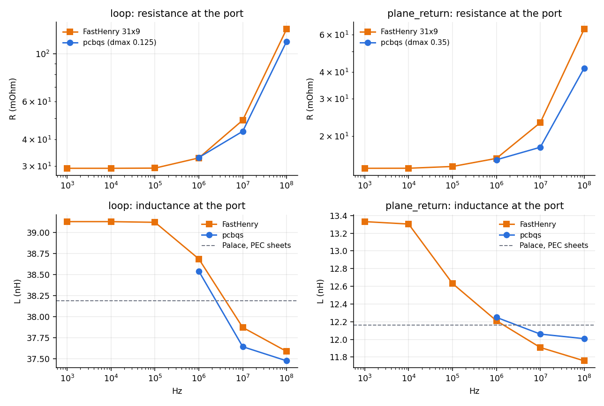
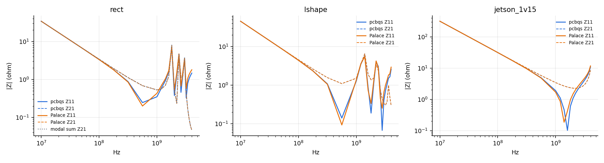

# Validation against independent solvers

pcbqs's power tools checked against solvers built on other methods, on cases with closed forms and on real
boards. Each script runs pcbqs and the reference over a ladder of mesh sizes and draws both converging.
Last run 2026-11-09. Reference tools: Elmer 26.2, Palace 0.18.1, FastHenry 3.0.1.

| Feature | pcbqs | Reference | Script |
|---|---|---|---|
| DC drop (`pdn` DC) | 2D copper sheets + via barrels (`pdn.dc.Network`) | Elmer 26.2 `StatCurrentSolver`: 3D copper slabs and barrels, direct solve | `dc_elmer.py` |
| Loop inductance, near field (`mqs`) | PEEC on the copper sheets (`MQS`) | Palace 0.18 driven FEM: PEC copper sheets, PEC via rods, air box, lumped port | `mqs_palace.py` |
| Copper R(f), L(f) (`mqs`) | the same, slab loss model | FastHenry 3.0: volume filaments across width and thickness (skin and proximity effect) | `mqs_fasthenry.py` |
| Board temperature (`thermal`) | layered sheets: copper + laminate per layer, dielectric and barrels between, films on faces and edges (grid and mesh) | Elmer 26.2 heat equation through kicad2ems-fem: 3D copper, barrels, anisotropic laminate (wedges) | `thermal_elmer.py` |
| Plane-pair impedance (`pdn` PDN) | 2D cavity (`pdn.cavity.PlanePair`) | Palace driven FEM: dielectric between PEC planes, open sides, lumped ports; analytic modal sum | `pdn_palace.py` |

## Results (finest meshes)

| Case | pcbqs | Reference | Difference |
|---|---|---|---|
| DC: 50 × 5 mm strip | 3.9409 mV | Elmer 3.9406 mV; closed form 3.9409 mV | +0.01% |
| DC: two plates, one via (r 0.15 mm) | 2.006 mV | Elmer 2.097 mV | −4.4% |
| DC: strip, 2 × 2 vias, strip | 4.256 mV | Elmer 4.276 mV | −0.45% |
| DC: wpthb VHB, L3 → Q1 / Q2 | 0.3828 / 0.6168 mV | Elmer 0.3835 / 0.6179 mV | −0.2% |
| DC: Jetson +1V15, R7 → U21 (2 A) | 7.620 mV | Elmer 7.733 mV (still falling with h) | −1.5% |
| L: 20 × 10 mm strip loop, 1 / 10 / 100 MHz | 38.54 / 37.64 / 37.48 nH | FastHenry 38.69 / 37.87 / 37.59 nH; Palace (zero-thickness PEC) 38.14 | −0.4 / −0.6 / −0.3% |
| L: trace over plane, via return | 12.25 / 12.06 / 12.01 nH | FastHenry 12.21 / 11.91 / 11.76 nH; Palace 12.16 | +0.3 / +1.3 / +2.1% |
| R: strip loop, 1 / 10 / 100 MHz | 32.9 / 43.6 / 114 mΩ | FastHenry 32.8 / 49.1 / 130 mΩ | +0.4 / −11 / −12% |
| R: trace over plane | 15.5 / 17.8 / 41.7 mΩ | FastHenry 15.8 / 23.2 / 63.6 mΩ | −1.5 / −23 / −34% |
| \|H\| 1 mm above loop / trace | centre 66.3 / 103.7 A/m per A | Palace 69.9 / 99.6 | −5% / +4% |
| Plane pair 40 × 30 mm, 10 MHz–3 GHz | \|Z21\| | Palace; modal sum | ≤ 0.4% |
| L-shaped plane pair | \|Z21\| | Palace | ≤ 0.8% |
| Jetson +1V15, In4.Cu over In3.Cu | \|Z21\| | Palace | ≤ 0.25% |
| Temperature: ten demo boards, 48 parts (2026-11-11) | each part, grid 0.5 mm | Elmer (h 0.3 mm) | ≤ 2.0 K (≤ 5.5% of rise); 43 within 1 K |
| Temperature: wpthb, Q1 / Q2 / L3 at 1 W | 53.74 / 52.28 / 54.04 C | Elmer 53.71 / 52.20 / 53.17 C | +0.03 / +0.08 / +0.87 K |

 





## What it found and changed in pcbqs

- **DC terminals were not equipotential** (`pdn/dc.py`). The ties from a pad to its mesh vertices shared
  1e6 S in total, but current enters a pad through the few vertices on its edge. Pads sat ~20 µV per amp off
  equipotential: +1% on the strip, growing as the mesh was refined. Ties are now 1e6 S per vertex, and the
  strip matches its closed form to 0.003% at every mesh.
- **DC meshes had slivers at vias** (`_numerics/geo.py`, `pdn/dc.py`). Triangle ran with an area limit but
  no minimum angle, so a via's octagon fanned out to vertices 2 mm away whatever `dmax` was. The linear
  elements then underestimated each via junction's spreading resistance by ~0.1 mΩ, which refinement could
  not fix. DC meshes now use a 25° minimum angle; the RF and near-field meshes are unchanged.
  - Jetson +1V15 drop: 5.78 → 6.18 mV (+7%).
  - Its PDN impedance peak, which uses the same pad-to-via conduction for mounting inductance: +5.7%.
  - wpthb: −0.05%, because its series parts dominate.
- DC loss is now the terminals' input power, not V·G·V, which cancelled across the stiffer ties.

## What remains different, and why

- **Single small via, −4.4%.** The plates agree with Elmer when the via is replaced by a round pad of the same
  radius. The rest is the junction: Elmer's barrel meets the copper slab through its end face and wall, while
  pcbqs ties it to the ring of a 2D sheet. On real boards, where vias are a fraction of the path, this is
  0.2–1.5%.
- **Inductance agrees, |H| within ~5%.** Against FastHenry, which resolves the copper's thickness, pcbqs is
  within 0.6% on the loop and 2% over the plane. Palace's zero-thickness PEC sheets sit ~1% above both, so the
  gap to Palace is the thickness, not a pcbqs bias.
- **AC resistance is low once the skin depth is below the copper thickness** (above ~3 MHz for 35 µm). The
  slab model spreads the current over one or both faces (`conductor_faces`) of every sheet alike. An isolated
  strip carries it on both faces and its edges, while a trace over a plane and the plane under it crowd it onto
  the facing surfaces. The result is 11–12% low on the loop and 23–34% low over the plane at 10–100 MHz, and
  `conductor_faces=1` overshoots instead (+19 / +70% and +8 / +31%). Below ~1 MHz pcbqs agrees to 1.5%.
- **A pcbqs terminal is one node.** A part attaches at its pads as a whole, so current crosses a pad
  instantly. In a small loop with large pads this lowers inductance: the 20 × 10 mm loop read 37.4 nH with
  1 mm pads against 38.8 nH with 0.25 mm ones. Here terminals are 0.1 mm slivers at the gap, matching
  Palace's gap port. On real converter loops the part-to-pad model (filament at `part_h`) matters at the
  same scale.
  - Since 2026-11-10 the tools attach a two-pad chip part where its metal is (`pcbqs.contacts`,
    `pad_contact='termination'`). The end cap sits on the pad from (body length / 2 − cap band) to the body's end,
    and the solder fillet joins the rest of the pad to the cap's end face. So the contact is the pad from the cap
    outward, and only the bare copper under the ceramic is left out. Sizes come from the footprint name (0402:
    1.0 mm body, 0.25 mm band; 1206: 3.2 mm, 0.5 mm). Otherwise, and for ICs and through-hole pads, the contact
    is the whole pad. On KiCad's footprints this covers 83% (1206) to 95% (0805) of the pad, so whole pads were
    nearly right:

    | Case | whole pad | termination (default) | 0.1 mm inner edge (a bound) |
    |---|---|---|---|
    | CM5 U702 input loop, L at fsw (dmax 0.8, fine 0.25) | 1.600 nH | 1.567 nH (−2%) | 1.495 nH |
    | wpthb VHB port TP7/TP6, board only, 100 MHz (dmax 0.3) | 152.1 pH | 152.9 pH (+0.5%) | 404.5 pH (dmax 0.8) |
    | wpthb circuit, 90 kHz 10 W: settled bus ripple | 0.764 V | 0.786 V (+2.9%) | |

    The port's board inductance converges slowly: 115, 158, 165, 153, 148 pH at dmax 0.8, 0.6, 0.4, 0.3, 0.25
    (`wpthb_vhb_port.py`, compressed backend below 0.8), so about 150 pH ± 7%.
    The contact still matters: a part touching only its pads' inner edges would read 2.7× higher on wpthb's port,
    because its 1206 caps span most of the 6 mm between TP7 and TP6, over In1's GND plane 0.1 mm below. A first
    version of `contacts` put the contact on the pad's inner half, toward the body, and read 2.5× higher. That
    was wrong for chip parts: the inner part of a KiCad pad lies under the bare ceramic.
- **Plane-pair Z11 differs from Palace by a constant 13 pH (0.1 mm) or 33 pH (0.2 mm).** This is a port-shape
  effect: Palace's flat strip port against pcbqs's disc. Z21, the cavity itself, agrees.

## In progress

- **Capacitance against FasterCap** (`cap_fastercap.py`; FasterCap 6.0.7 built headless at
  `~/opt/src/FasterCap-build`). Zero-thickness copper in FasterCap matches pcbqs's sheets:

  | Case | pcbqs (dmax 0.25) | FasterCap | Difference |
  |---|---|---|---|
  | Plates 10 × 10 mm, 0.5 mm apart, air | 2.170 / −1.953 pF | 2.168 / −1.952 pF | < 0.1% |
  | Microstrip 0.3 mm over 0.2 mm, 20 mm, air | 0.623 pF to ground −0.612 | 0.638 / −0.627 (0.05% tol.) | −2.4% |
  | Two traces, 0.1 mm apart, air: self / mutual / to ground | 0.666 / −0.152 / −0.505 | 0.696 / −0.171 / −0.516 (±3%) | −4 / −11 / −2% |
  | Microstrip, FR-4 / air ratio (effective permittivity) | 3.23 | Hammerstad–Jensen 3.26 | −1% |

  - pcbqs is a little low on narrow traces, most where they face each other across a small gap. Its
    constant charge per triangle can't fully resolve the edge charge within the dense solver's memory limits.
  - Copper thickness is not small here. 35 µm boxes in FasterCap give the air microstrip 0.713 pF, +12% over the
    sheets, and that is capacitance pcbqs leaves out.
  - Gotchas:
    - A pcbqs terminal has one charge density, so keep it small: a whole-conductor terminal removed half of a
      narrow trace's capacitance.
    - FasterCap needs `-a` ≤ 0.002 (0.5% stopped ~3% low).
    - FasterCap's out-of-core files go to TMPDIR, which is RAM here; full, it aborted with "File error". The
      script uses each run's folder.
    - FasterCap on FR-4 (copper on the interface) stayed non-physical, even with the slab trimmed to the plane
      as in FastFieldSolvers' white paper WP130527, so FR-4 is checked against Hammerstad–Jensen instead.
- **Two face sheets for AC resistance** (`MQS(thickness_sheets=2)`, C14): the strip loop's 10–100 MHz error
  falls from −20% to −12%. Mesh limits remain.
  - The face correction removed each pair's own opposite-mode inductance but not the coupling between
    neighbouring pairs. On CM5 the opposite modes were then nearly free and coupled, and GMRES stalled at 1–10 MHz
    (residual 1e-3 after 500 iterations). `face_correction='overlap'` (experimental) also removes the coupling of
    pairs whose edges share a triangle, as the slab's Gram terms do. CM5 then converges at every frequency
    (220–325 iterations). The plane return's 100 MHz resistance goes from −12.9% to −7.2% against FastHenry; the
    strip loop is unchanged.
- **A real converter loop: CM5 MINIMA's U702 input loop** (`mqs_cm5.py`, `images/mqs_cm5.png`). Six layers of
  +5V and GND copper inside 9.4 x 13.7 mm, 17 vias. Each capacitor is a copper bridge across its pads, and the
  port is across the 0.2 mm gap between U702's VIN pad and the GND pad beside it, so all three tools see the same
  copper and no pad is shorted (C13). Loop L at 100 MHz:

  | | mesh ladder | finest |
  |---|---|---|
  | Palace, PEC sheets (h 0.5 → 0.25) | 0.336, 0.353, 0.356 nH (rising) | 286k tets, 260 s |
  | pcbqs, one sheet (dmax 0.8 → 0.35) | 0.430, 0.404, 0.383, 0.371 nH (falling) | 38k triangles, 48 s, 4.6 GB |
  | pcbqs, two face sheets, overlap | 0.344, 0.320, 0.300, 0.292 nH (falling) | 76k triangles, 320 s |

  One sheet and Palace's zero-thickness sheets close in from either side (4% apart). Two face sheets sit lower;
  part of that is real (the faces narrow the 0.1 mm B.Cu–In4 gap to 0.074 mm). R at 100 MHz is 9.9 mOhm with one
  sheet and 18.2 with two. FastHenry (`mqs_cm5.py fasthenry 0.2`: the copper rasterised to a 0.2 mm grid of
  segments, 28k segments) decides between them; that run is in progress. The compressed backend matched dense to
  four digits here, in a tenth of the memory.
  - Palace needed one fix in `mqs_palace.palace_mesh`: copper inside a via rod was left behind as a disc bounding
    no volume (MFEM's STable3D abort). Such surfaces are now found by position and dropped.

- **Two face sheets near a plane, and the stacked-sheet reference** (`face_study.py`): a 1 mm trace over a plane
  1.6 or 0.1 mm away (centre to centre), 15 or 35 um thick, against FastHenry (refined: 61 x 9 filaments, within
  1.6% of its default run).
  - Two faces with the overlap correction: R within 0.1% at 1.6 mm, but +254% at 0.1 mm and 100 MHz, current
    circulating between each conductor's faces. No setting of the face correction works at both spacings: the slab
    two-port is driven by the faces' own currents, while the copper responds to the field at its faces, which a
    trace 65 um above the plane dominates. The corrections were removed (2026-11-10); with the copper placed in
    its real slab and the terminal bug fixed, uncorrected faces are within ~10% of FastHenry in every case and the
    `conductor_loss='slab'` default.
  - `MQS(thickness_sheets=N, conductor_loss='dc')`: N sheets through the copper, cosine-graded toward its faces,
    each at its slice's DC sheet resistance: skin and proximity effect from mutual inductance alone, no slab
    formula. N = 6, dmax 0.25, 10 cells across the trace: at 0.1 mm, R within 4% and L within 1% at 1–100 MHz; at
    1.6 mm, L within 2% but R -11..+6% and moving with edge refinement (each sheet's free edge crowds current
    without bound, where copper turns it down its side: the side walls' job). 5 minutes for 66k triangles: the
    reference, not the default.
  - Across the board the trace needs about 10 cells (`edge_rings`, `edge_width` = trace width): at dmax 0.5 a 1 mm
    trace is two triangles wide and every model was -21% at 10 MHz. Part of every earlier face-sheet error was this.

## Not done yet

- **Measurement.** VNA shunt-through on a PDN, and a near-field probe at 1–3 mm, on wpthb.

## Running

```sh
export PYTHONPATH=src:../kicad2ems/src
python validation/dc_elmer.py [strip via_single via_hop wpthb_vhb jetson_1v15]    # ElmerSolver, ElmerGrid, gmsh
python validation/pdn_palace.py [rect lshape jetson_1v15]                          # Palace (podman image or native)
python validation/mqs_palace.py [loop plane_return]
python validation/mqs_fasthenry.py [loop plane_return]                             # after mqs_palace.py
python validation/mqs_cm5.py geometry|pcbqs DMAX [SHEETS] [hier] [overlap]|palace H...|fasthenry P...|figure|report
python validation/thermal_elmer.py [05_buck_synchronous ...] | --wpthb          # + ../kicad2ems-fem/src
python validation/dc_elmer.py --plot        # redraw from saved results (also mqs_palace.py --plot)
```

FastHenry 3.0 (MIT, FastFieldSolvers' Linux fixes) is K&R C that GCC 15+ rejects by default (C23: `f()` means no
arguments; implicit declarations are errors). It builds as the C89 dialect:

```sh
git clone --depth 1 https://github.com/ediloren/FastHenry2.git ~/opt/src/FastHenry2
cd ~/opt/src/FastHenry2/src/fasthenry
make fasthenry CC=gcc CFLAGS="-O2 -std=gnu89 -fcommon -w -DFOUR"      # -> ../../bin/fasthenry
```

Its input's first line is a title (a `.units` there is silently ignored), node names start with N, and it exits
non-zero after a successful run; `mqs_fasthenry.py` handles all three.

Run data go to `PCBQS_VALIDATION_OUT` (default `~/pcbqs-bench/validation`); figures to `images/`. Palace is found
as `K2E_PALACE` (an executable) or `K2E_PALACE_ROOTFS` (an unpacked image, default `~/opt/palace/rootfs`), as in
kicad2ems-palace. The biggest runs use about 1.1 M tetrahedra (Elmer, Jetson) and 0.5 M (Palace, 2 MPI ranks) in
under 32 GB; pcbqs's dense PEEC limits the MQS cases to ~12 k triangles.
